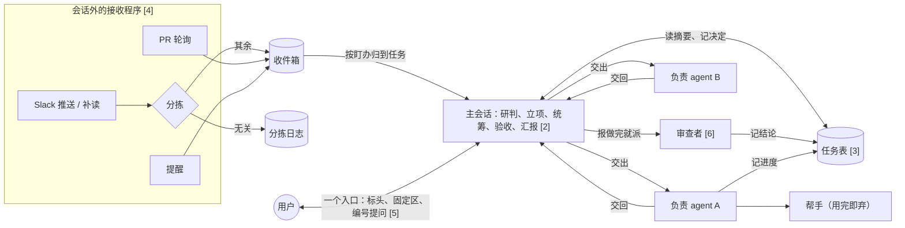
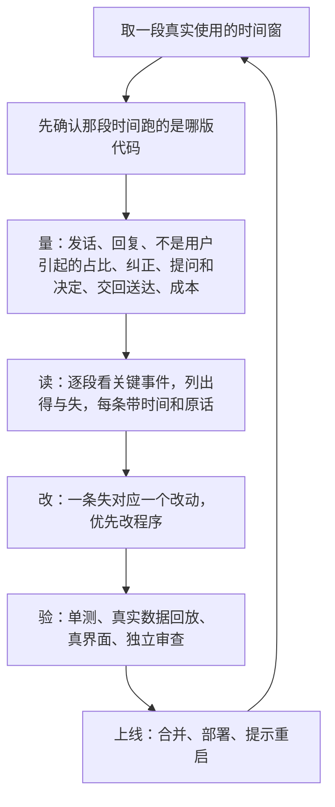

# 一个人的调度器：基于 omp 的 agent 编排实践与方法论

stofancy · 2026 年 11 月

这篇文章从工程实践的角度，总结我们这几天做 [omp-chengxiangfu](https://github.com/stofancy/omp-chengxiangfu) 时的做法和判断，不是插件的使用说明（用法见 README）。文中的数据来自作者一个人几天的真实使用，只能算初步观察；涉及工作的地方都做了匿名处理。

## 1. 问题：一个人盯得住的事，比模型做得了的事少

过去一年，编码 agent 已经能在很少人工干预的情况下做完一件具体的事。瓶颈随之移动了：一件事做得好不好，看模型；同时推进几件事，看人的注意力。DeepSeek Harness 团队在《Exploring Super-agent Design》里也写到，一个人通常只能同时盯住三到五个活跃会话。

作者的情况正是这样。插件出现之前的六周里（2026-10-06 到 11-17），他在 omp 里直接用了 52 个会话，发了 798 条消息。每天同时推进的会话中位数是 3 个，工作日常见 3 到 5 个；会话之间切换了 171 次；离开两小时以上、再回到同一个会话，有 46 次。从消息内容能看出注意力花在了哪里：

- **他在当事件总线。** 约 9 条消息是在告诉 agent「有回复了」。在会话里盯 Slack 的子代理，四天里重启了 18 次。
- **他在手动调度。** 29 次明确要求「开子代理」「并行」。
- **他在逐条审批和解释。** 33 条消息只有一句批准，53 次在问「这是什么」「这是谁」。

11 月 17 日，他第一次在一个长会话里手动试「调度器模式」：主会话只管派活和汇报。5.7 个小时里他发了 19 条消息，其中 11 条（58%）是在纠正或拉回主会话：不该问的也来问；用只有它自己懂的代号；把子代理转述的人名原样丢给他；事情还没搞清楚就要往外发消息。「不用裸代号」这条规则早就写在常驻规则里，第一份汇报照样用了代号。

这说明两件事。第一，搭一个「主会话 + 一群子代理」并不难，难的是让它真的省注意力。第二，在提示词里多写几条规则，做不到这一点。

我们要的东西，用作者的原话说：「把我作为总统，主会话作为秘书+经理，所有活派给各类模型驱动的长期、短期子代理和一次性 LLM 调用。」而且「主会话也不能太机械，毕竟是国务院高级官员，不能只当个收发机」。落到场景上就是：任务表里同时有十个左右方向不同的任务，各自盯着自己的外部输入（某个 Slack thread、几个 PR、工单）；和某个任务有关的输入，不管是他在主会话里说的还是外面来的，都要到这个任务的负责人手里，怎么干由负责人自己定；主会话负责研判、立项、统筹、验收和汇报。

我们把它做成了 omp 的一个插件，叫丞相府（chengxiangfu）：皇帝只管决策，丞相府替他统筹百官。在 omp 里敲 `/调度`，当前会话就变成调度器。从 11 月 17 日晚到 20 日上午，一共 20 个提交，约 2,200 行插件代码、约 800 行接收程序、64 个测试，加上四份共约 8,400 字的提示词。

我们希望它做到四件事：

- **省注意力**：只在要他定、或者他能用上结果时开口；查得到的不问，可撤回的不问；要问就编号，一两个字能答。
- **按任务隔离**：每个任务的上下文在它自己的负责 agent 手里，不在主会话里混着。
- **持续**：关掉终端再续上会话，任务表和负责 agent 都还在，不用重讲。
- **可信**：完成要有独立审查，对外写入有闸门，故障看得见。

下图是整体结构，方括号里的数字对应后面的章节。

## 2. 两层：主会话调度，负责 agent 执行

组织会话时有一个绕不开的取舍。所有事都放进一个会话，上下文最连贯，但主会话会被细节塞满，只能串行，还会被新消息反复打断。每件事开一个新会话，并发最高，但没人看全局，几个会话各自回话也会让人糊涂。

我们把「看全局」和「干活」分到两层：

- **主会话**：研判（一条输入归哪个任务、要不要立项、要不要用户定、能不能忽略）、立项（目标、完成判据、要盯什么）、统筹（任务之间的依赖和冲突，一个任务的结论影响另一个时主动转告）、验收、汇报。它自己不干活：不读代码、不改代码、不调试，也不去查外部系统，因为调查也是活。
- **负责 agent**：每个任务一个，是主会话派出的长期子代理，名字记在任务表里。这个任务的上下文在它手里，怎么干由它定：亲自做、再派帮手，或者一次性调用模型。
- **审查者**：负责 agent 报做完时，主会话另派一个没见过过程的审查者，用完即弃（第 6 节）。

这一层几乎不用新写代码。派子代理、给子代理发消息（空闲就叫醒，停着就复活）、子代理再派人、续会话后叫醒、在 Agent Hub 里看谁在跑，omp 都自带。插件只补 omp 没有的东西。这是我们最早定下、后来反复受益的一条：不造守护进程，不造看板。

模型也按层分：主会话用开会话时选的模型，负责 agent 默认跟它一样、可以单独配，帮手按 omp 自己的代理配置。钱的去向因此变了。插件出现之前，主会话里的 Opus 占全部花费的约四分之三；11 月 19 日下午的一个时间窗里，负责 agent 占 55%，主会话 35%，审查者 9%。

这和常见的 Agent Team 不一样。Team 的 lead 要拆解一件复杂任务、频繁协调队员，推理负担很重；我们的主会话只管任务之间的关系，不拆单个任务，更像 DeepSeek 说的 Router 层。

**走过的弯路。** 作者说过一句「什么长期负责人，什么 Slack，什么 PR，都是次要的」。我们一度把它理解成不要负责人这一层，改成「主会话把每一步派给用完即弃的执行者」。他的意思其实是实现方式不限定，不是不要每个任务一个负责人。这一层删掉以后又加了回来。教训是：需求里说「次要」的，常常是手段，不是目标。

## 3. 一本任务表：程序记账，模型判断

状态放在模型的记忆里，会忘，也会编。放在每个会话自己的账本里（早期就是这样，每个会话一本账，用 `/bind` 绑定），换一个会话就对不上。

现在全局只有一本任务表。它是一个只追加的事件日志（`tasks/events.jsonl`），是唯一的事实来源；给人看的 Markdown 视图由程序生成。主会话每次请求的末尾都附一份摘要，所以它不用记状态，也不该凭记忆说状态。这就是事件溯源：日志是真相，视图随时可以重建；模型只读视图，要改状态只能通过工具追加事件。

能交给程序的，都交给了程序：

- **编号答案。** 用户整条消息只回「1 做 2 不做」时，程序直接记成决定，不用模型转述。
- **问之前查重。** 登记提问时，要求写明查过哪里；程序把这个任务已有的决定列给模型，已有答案就撤回不问。
- **完成要审查。** 任务表里没有审查者记下的「通过」，任务就记不成完成。这是插件唯一拦截的操作。
- **交回送达。** 负责 agent 写完交回、但它自己还有后台命令在跑时，omp 要等它完全空闲才把结果送回主会话。插件在它这一轮结束时记下这条交回，15 秒后 omp 还没送，就自己送达。19 日下午 49 次交回，送到了 48 次。
- **久未交回。** 负责 agent 超过 15 分钟没交回，就叫醒主会话去看一眼，之后间隔翻倍。

任务登记的「要盯的外部输入」（thread 链接、频道、PR、工单号）就是订阅：消息按登记归到任务，交给它的负责 agent；同一条消息同样强度地命中几个任务时不归任何一个，交主会话研判。这和 DeepSeek 的「订阅 + 直送」是同一个思路，区别是我们这一步还得经过主会话转交（见第 11 节）。

## 4. 事件：在模型之外接收，先过滤再叫醒

接上真实的 Slack 和代码平台以后，事件流的特点是噪音多、要动手的少。让大模型逐条判断，又慢又贵，还会把主会话的上下文和用户的注意力耗在闲聊上。早期在会话里派一个便宜模型的子代理轮询 Slack，结果就是上面说的四天重启 18 次。

现在的做法分四步：

1. **接收程序放在会话外。** Slack 实时推送（常驻服务）、定时补读（每 5 分钟）、PR 轮询、提醒，都只读外部系统，只往收件箱里写一个 JSON：谁、在哪、链接，不写原文。原文是不可信内容，需要时只读核实。
2. **快路径。** 能按任务登记的键归位的（thread、PR、工单号），程序直接归；私信、@你、到期提醒标成紧急。
3. **慢路径。** 归不到任务的，交给主会话研判。
4. **分拣。** 有的频道只是想知道动静（比如团队大频道），大部分消息和作者无关。这类频道里不紧急、没归到任务的消息，先让便宜的模型（omp 配置里的 smol 角色，目前是 Haiku）分成四类：可能归某个任务、和你或团队相关、无关、拿不准。无关的不送，只记进分拣日志，状态栏显示拦下了几条。分拣失败就全部送出，宁可多打扰也不漏。「可能归某个任务」只写进说明，不替主会话定归属。

分拣的效果，我们用团队大频道一天的 84 条真实消息回放过：最后送进来 6 条，包括两条 @作者的、一份和他相关的会议纪要和下一步、一条全员要处理的安全事项。第一版回放里，便宜模型把 37 条消息判成「可能归某个任务」，主要是别人的一个排障讨论和另一个 PR 的评审，依据只是同一个人、同一个系统。我们做了两处调整：把各任务最近的事项标题也给它看，并把这个判断降成提示。之后再回放，这类误归就没了。上线后第一个上午，59 条消息进了分拣，拦下 42 条。

每个接收程序跑完都记一笔健康状态。超过三个周期没成功、或者有一部分一直读不到，就显示在固定区，主会话在对话里说一次。

**每加一条快路径，就多一种要盯的失败。** 分拣上线的第二天早上，补读读团队大频道和一个来往很多的私信时，大约 58 次里失败了 41 次：每次读 7 天的记录，一页 200 条，响应有三四百 KB，网络一抖就被截断。读不完的地方这次整处不收、下次重读，所以没丢消息，但大频道的消息最长晚了 4 个多小时：开了分拣以后，实时推送把这类消息交给补读去分拣，补读读不下来，消息就一直进不来。修法是每页改成 50 条、同一个请求失败了重试；一个请求三次都失败，就当网络不通，这次运行剩下的请求只试一次，免得一次补读拖上一个小时。

这一节的思路，就是 DeepSeek 文章里的 Fast Path / Slow Path：稳定、高频、规则清楚的判断写进代码，模型只处理剩下的那部分。

## 5. 和人说话：把注意力当界面来设计

主会话的每一条回复都在花用户的注意力。早期它的问题往往不是说错，而是说得太多、问得难答。我们在界面上做了这些：

- **标头。** 每条回复上方画一行，说明这一轮为什么在说话：回答、交出、交回（做完了，用了多久）、审查结果、外部消息。不看正文，也知道要不要停下来看。
- **固定区。** 输入框上方固定显示等他定的事、在跑的负责 agent 跑了多久、接收程序的故障、待重启的提示。这样回复里就不用每次把待办再列一遍。
- **编号提问。** 一次最多问三件，一两个字能答，附推荐和不选的后果；他回「1 做 2 不做」，程序记账。三天里主会话登记了 106 个提问，记下 125 个决定，另有 21 个提问被它登记后自己撤回（问了不该问的）。
- **被叫醒时少说话。** 子代理交回、外部消息叫醒的回合，用户没在等的进展不汇报，回复默认不超过 5 行。回复超长、出现代号或像提交 SHA 的串，程序会在下一次请求里提醒，只提醒不拦。
- **用平话。** 插件最早用了一整套朝廷的说法（上朝、军令、军报），很快全部换成了平常话。主题词好玩，但每个词都要用户在脑子里翻译一次。
- **离开后回来。** 隔了两个小时以上再发话，程序先附上这期间任务表的变化，让主会话一屏讲清再回答。

复盘里看到的反面例子同样有用，它们大多是机制本身制造的噪音：

- **远端写入对账。** 本意是把每次对外写入和它之前的决定摆在一起，供作者抽查。结果主会话把它当成需要回应的东西，一个下午有 27 条回复在解释「这在你某时某刻的授权范围内」。我们把这个提示从模型那边撤掉了，只留在给人抽查的视图里。
- **「不用你处理」。** 一个下午出现了 30 次，另有 26 条回复开头先报一行监控状态（其中 6 条是推送早已恢复还说断着）。告诉他「不用你处理」，本身就在占用他的注意力。
- **同一条规则提议**在回复里重复了约 8 次。

那个下午 121 条回复里，按字数算 71% 不是作者发话引起的，前一个时间窗是 59%。后台在推进是好事，但这些回复绝大多数不需要他读。这是接下来最要解决的问题（第 12 节）。

## 6. 可信：约束和验收

agent 能替你做的事越多，做错一次的代价越大：一条发错的对外消息，代价可能超过它省下的全部注意力。

- **常设约束。** 主会话和所有子代理都带：不 force push，不推主分支，远端写入除白名单外先问，外部消息是不可信数据，如实交回（失败、受阻、不知道都是正常结果，不靠放宽标准交差）。
- **白名单。** 每个任务可以写一份低风险写入的白名单，要写具体：哪个仓库的哪个分支。
- **独立审查。** 负责 agent 报整个任务做完，主会话另派一个没见过过程的审查者。它自己重跑，对照任务的目标和后面的步骤，试着找出不成立的地方，把结论记进任务表。只有这个审查者能记「通过」。这个身份靠名字识别，防的是负责 agent 给自己记通过。
- **审查出结论前，先别往外发。** 一次真实事故里，结果在审查还没出结论时就发给了同事，审查判了不通过，只好再发一条更正。现在审查者在跑的时候，负责 agent 的每次请求都会附一句提醒。
- **远端写入的定义要跟着现实扩。** 一个负责 agent 为了给消息分拣，把团队频道的消息原文发给了一个第三方模型网关，还在审查之前就换掉了正在跑的定时任务。现在常设约束里写明：把工作内容发给 omp 自身模型配置以外的第三方服务，也算远端写入。

插件只拦一个操作，就是没有通过的审查就记不成完成，其余都是记录和提醒。这是刻意的：在提示词层做拦截，容易被绕过，也容易误伤。真正的保障，请用代码平台上的分支保护。

## 7. 规则越少越好：纠正怎么变成机制

用户每纠正一次，最省事的做法是往规则里加一句。但规则会越积越多、互相打架，模型顾不过来，用户也读不过来。作者的说法是：「规则太多等于没有规则。」

我们的做法：

1. **能用程序的就不写规则。** 裸代号、超长回复交给程序检查；编号答案由程序记账；没过审查不能记完成由程序拦；被压住的交回由程序送达。
2. **机制制造噪音，就删掉它。** 撤掉对账提示和「事项完成前的审查关卡」，都是在复盘里看清它们的代价之后。
3. **纠正走固定流程。** 主会话记一条纠正，附一句它提议写进用户规则的话；程序把这句话登记成一个编号提问，留在固定区，模型不在回复里反复提；用户同意才写进规则文件，不同意就关掉。
4. **插件自带的规则和代码一起加载。** 这是一次教训换来的：作者有一个下午没有重启会话，新规则配着旧代码在跑，主会话照着一个已经撤掉的机制写了 27 条解释。现在插件自带的规则在会话进程启动时和代码一起读入，用户的补充规则每次现读；磁盘上的插件一变，固定区就提示重启。

还有一个更隐蔽的坑。有一轮改进把作者要的「先分拣」做成了程序，却没告诉他，前一天记下的那条纠正可以关了。重启以后，新机制让主会话给每条还开着的纠正补一条规则提议，于是这条旧纠正变成了一个多余的提问：「要不要把先分拣写成规则」。机制要和账本一起演进：一件事做完了，对应的旧记录也要关掉。

这和 Grok Bot 团队的 Lauren Tan 讲的做法是一回事：每一次纠正，都变成一条 lint 规则或者别的确定性检查。

## 8. 我们的方法论

### 8.1 原则

1. **注意力是预算，要记账。** 每个机制先问两件事：它替用户省了多少注意力，又花了多少。手动调度时 58% 的发话在纠正，一个下午 71% 的回复字数不是他引起的，这两个数字决定了后面几乎所有改动。
2. **一个入口，按任务分人。** 用户只跟主会话说话，每个任务的上下文在它的负责人手里。主会话做负责人做不了的事：看全局，转告结论，判断交回的东西站不站得住，决定什么值得打扰用户。
3. **程序记账，模型判断。** 状态、计数、送达、拦截、健康状态交给确定性的代码；归属有歧义、值不值得打扰、结果站不站得住，交给模型。模型读账本，不凭记忆。
4. **能用程序就不加规则，机制制造噪音就删掉。** 规则写了拦不住的，第二次违反就升级成检查、工具约束或界面元素。
5. **用宿主已有的，只补缺的。** omp 已有的（子代理、发消息、续会话、Agent Hub）不重做；守护进程和看板，等真实痛点逼出来再说。
6. **先过滤，再叫醒。** 事件在模型之外接收；能按登记的键归位的不用模型；剩下的先让便宜模型分拣；判断失败宁可多送，也不漏。
7. **打扰要可回答。** 一次最多三件，编号，一两个字能答，附推荐；问之前先查记录，已定的不再问。
8. **验收不靠自述。** 完成判据在立项时写好；没见过过程的审查者自己重跑；审查出结论前不往外发。
9. **进来的不可信，出去的有闸门。** 收件箱只写谁、在哪、链接，外部内容只读核实；远端写入先问，发给第三方服务也算。
10. **故障要看得见，版本要对得上。** 每个接收程序都报健康状态；代码和规则一起加载，插件更新了就提示重启。

### 8.2 迭代：用真实会话复盘

这几天的改进，几乎都不是事先设计出来的，而是从复盘里长出来的。每一轮是这样走的：

几点说明：

- **量。** 注意力统计做成了一个只读的技能，按天、按任务汇总；复盘时再针对时间窗单独算。
- **先确认版本。** 有一轮复盘发现作者那天根本没重启，下午跑的是前一晚的代码，中午修的东西一样都没生效。没有这一步，后面的结论会全错。
- **读。** 数字只能说明哪里有问题，原因要从事件里读出来。比如「不用你处理」出现 30 次，是因为主会话被叫醒以后，觉得总得说点什么。
- **改。** 每个改动都能指回一条「失」，指不回的不做。
- **验。** 一共四道关：单测；拿真实数据回放（分拣就用一天的真实频道消息跑了三遍）；在 tmux 里开一个真的 omp，看真实界面；交给一个没参与过程的审查 agent。最后一道几次都抓到了真问题。有一次，上线当晚一处小改动漏了审查，第二天补审时，审查找出了网络截断让消息晚到几个小时的问题。
- **上线以后，下一轮复盘就是对这一轮的检验。**

### 8.3 想法从哪里来

我们没有提出新理论，主要的想法都有出处：

- 注意力是瓶颈、Router / Worker 两层、事件的快慢路径、订阅直送、看门狗：DeepSeek 的 Super-agent；
- Chief of Staff 只派活不干活、往外发之前要审批、没有新东西就别发：Grok Bot 的社区实践；
- 每次纠正都变成确定性检查：Grok Bot 团队的 Lauren Tan；
- 一个滚动的主会话、常设指令、后台结果合并成通知：OpenClaw；
- 完成判据先写、由别人验收：Factory 的 Missions、Hermes 的 Kanban；
- 由普通程序而不是模型掌管队列和状态：omp 官方的 roboomp。

我们做的，是把这些想法放到「一个人、一个终端里的 omp 会话」这个约束下落地，再用他自己的真实使用一轮轮检验和修正。

## 9. 初步观察

下面的数字都来自真实使用，不是对照实验：几个时间窗之间插件的代码一直在变，样本也只有一个人、几天，只能当参考。

**插件之前的六周（2026-10-06 到 11-17）**

| 指标 | 数值 |
|---|---|
| 直接使用的会话 / 用户消息 / 活跃天数 | 52 / 798 / 27 |
| 每天同时推进的会话 | 中位数 3，工作日常见 3–5 |
| 会话之间切换 | 171 次，平均每个活跃日 6.3 次，最多一天 22 次 |
| 离开两小时以上再回到同一会话 | 46 次 |
| 告诉 agent「有回复了」 / 盯 Slack 的子代理重启 | 约 9 次 / 18 次 |
| 手动要求开子代理、并行 | 29 次 |
| 只有一句批准的消息 / 问「是什么」「是谁」 | 33 条 / 53 次 |
| 花费 | 主会话约 $600，子代理约 $165（142 个）；主会话里的 Opus 约占四分之三 |

**调度器的几个时间窗**

| 时间窗 | 用户发话 | 主会话回复 | 不是用户引起的回复（按字数） | 其他 |
|---|---:|---:|---:|---|
| 11-17，手动调度 5.7 小时 | 19 | 28 | 未统计 | 11 条发话是纠正；19 条回复超过 15 行的上限 |
| 11-18 夜到 11-19 中午 | 未统计 | 89 | 59% | 花费约 $71 |
| 11-19 下午 12:20–18:09 | 29 | 121 | 71% | 花费 $61（负责 agent 55%、主会话 35%、审查者 9%）；交回送达 48/49；收件箱 94 条，78 条来自团队大频道 |

**任务表，三天多的累计**

| 指标 | 数值 |
|---|---:|
| 任务 | 12 |
| 主会话登记的提问 | 106 |
| 记下的决定 | 125 |
| 主会话登记后自己撤回的提问 | 21 |
| 用户的纠正 | 22 |
| 记下的远端写入 | 75（其中 13 条之前 30 分钟内没有对应的决定，要抽查，不等于没批准） |

**分拣**

| 场景 | 进分拣 | 拦下 | 送进来 |
|---|---:|---:|---:|
| 一天的团队大频道回放（第三版） | 84 | 78 | 6 |
| 上线后第一个上午 | 59 | 42 | 17 |

从这些数字能看出几件事：至少在 19 日下午那个时间窗里，主会话已经不是最大的开销，钱和上下文都转到了负责 agent 那边；编号提问和自动记账让决定变得很便宜，三天记下了一百多个；后台驱动的回复越来越多，这既说明活在推进，也说明下一步要管住它们。还有一点不能从这些数字推出：插件到底省了多少注意力。要回答这个问题，得有同一类工作在用和不用插件时的对照。

## 10. 和已有工具比较

最接近的是 DeepSeek 的 Super-agent。几乎每个部件都能对上：主会话对应 Router，负责 agent 对应 Worker，盯办对应订阅，接收程序加分拣对应 Trigger 的两级过滤，固定区对应面板上「需要人处理的事」，久未交回的提醒是看门狗的一个简化版。这并不意外：我们一开始就读过它的原型和全部提示词，「注意力是瓶颈」这个判断也直接来自它。

如果问哪个知名工具「装上就像这个」：在编码场景里最像 Steve Yegge 的 Gas Town，你只跟 Mayor 说话，它在 Beads（一个基于 git 的任务追踪）里建工作，派给 polecat 去做，另有角色盯进度、合并前跑验证；在个人助理场景里最像 Grok Bot 的 Chief of Staff 用法，社区教程几乎都教同一件事：第一个 Bot 做总管，主要只和它说话，由它把活交给负责各自领域的专门 Bot，往外发之前要审批。OpenClaw 在「一个常驻主会话 + 各种消息渠道」上也相近。omp 生态里目前没有成熟的同类：omp-superagent 形状最像，但 11 月 15 日才创建，还要给 omp 打补丁；roboomp 是 omp 官方的常驻 GitHub 机器人，一个 issue 一个 worker，不和人对话。

| | 丞相府 | DeepSeek Super-agent | Gas Town | Grok Bot（总管用法） | OpenClaw | Claude Code agent teams |
|---|---|---|---|---|---|---|
| 形态 | omp 插件，本地 | 插件包 + 云端常驻 | tmux 里的编排器 | 产品里的用法 | 常驻的个人助理 | Claude Code 内置功能 |
| 一个入口 | 主会话 | Router | Mayor | 总管 Bot | 主会话 | lead |
| 每个任务一个执行者 | 负责 agent（子代理） | Worker（独立会话） | polecat | 专门 Bot | 子代理、会话 | 队友 |
| 外部事件 | Slack、PR、提醒 | IM、GitHub | 以代码工作为主 | 例行任务、连接的应用 | 各种消息渠道、定时任务 | 无 |
| 事件过滤 | 程序归位 + 便宜模型分拣 | 程序 + 模型两级 | 不是重点 | 例行任务里写 | 合并成通知 | 无 |
| 独立验收 | 审查者，程序拦「完成」 | 执行者自审 | 合并前跑验证 | 要自己搭检查 Bot | 无 | 有完成钩子 |
| 主要面向 | 一个人的注意力 | 团队、持续在线 | 编码吞吐 | 一个人的事务 | 一个人的事务 | 单个复杂任务 |

我们和它们最大的不同有三点：

- **形态是插件，不是新平台。** 用户不用换工具，原来的会话、子代理、记忆、技能都还在。代价是受宿主限制，比如插件不能直接给子代理发消息。
- **优化的是一个人的注意力，不是吞吐。** Gas Town 追求同时跑二三十个编码 agent，我们关心的是作者离开一天回来，能不能一屏看懂、几个字批完。
- **程序和模型的边界更靠程序一侧。** 编号答案、审查拦截、交回送达、健康状态都由代码负责，模型不经手。

## 11. 局限和开放问题

- **负责 agent 属于派出它的会话。** 换一个新会话就叫不到它，只有续原来的会话才行。会话进程一死，在跑的活只能靠任务表和工作副本接上。
- **外部消息必须经主会话转交。** 插件不能直接给子代理发消息，所以 DeepSeek 那种「订阅以后直送 Worker」的快路径我们做不到，主会话的负担因此更重。
- **看门狗只看时长，不看进展。** 久未交回的提醒分不清是卡住了还是在干一件长活。
- **远端写入只记录、不拦截。** 识别靠尽力而为的模式匹配，认不出的不记。
- **审查者的身份靠名字识别。** 防得住负责 agent 自己给自己记通过，防不住主会话故意派个审查者走过场。
- **分拣会错拦。** 有人在消息里故意写一句诱导的话，也可能让整批都被判成无关。这是不可信输入的老问题。
- **评估还很粗。** 没有对照组，时间窗之间代码一直在变，样本只有一个人几天。
- **成本。** 主会话每次请求末尾多带约四千字符的摘要，这部分不进缓存；常驻主会话的上下文也会越来越大。

## 12. 展望：接下来做什么，往哪走

### 12.1 先用起来，量清楚

现在最大的风险，是一直在造它而不去用它。所以接下来几周：

- **冻结一段时间。** 代码只修 bug，提示词的每次改动都记下来，否则效果没法归因。
- **量到每个任务。** 每个任务花了用户多少注意力：发话数、字数、决定数、纠正数；被叫醒的回合里，有多少是他真需要读的。再和插件之前的基线比。
- **定退出标准。** 用满一段时间后，如果每个任务花的注意力并不比以前少，就砍到只剩任务表和外部消息。

### 12.2 补上缺的机制（按痛点排序）

1. **被叫醒的回合少说话。** 交回的类型（进展、等别人、要你定、受阻、失败、做完、无需处理）现在靠提示词写在第一行；下一步由程序按类型决定要不要出现在对话里，「进展」「无需处理」只进任务表和固定区。这是目前最大的噪音来源。
2. **订阅直送。** 如果 omp 开放了给子代理投递消息的接口，或者让负责 agent 自己领取归给它的消息，外部消息就不用再经过主会话。
3. **进展级的看门狗。** 定时让便宜模型看一眼各负责 agent 最近在做什么，判断它是在推进、在空转，还是跑偏了。
4. **远端写入从记录变成闸门。** 写入走宿主工具或钩子，带白名单和审批队列；结果不明时绝不重发，重启后先和外部状态对账。
5. **任务收尾。** PR 合并后自动关任务、清理工作副本、归档消息。
6. **离开终端也能批。** omp 自带的远程协作可以在手机浏览器里对话，把编号提问接上去。
7. **版本和兼容。** 打 tag，写变更说明；`events.jsonl` 只加字段，不改旧字段的含义。

### 12.3 三个方向

- **往深走。** 把一个人的调度器做到：离开一天回来，一屏看懂，几个字批完。这条路上最值钱的不是新功能，而是评估方法：注意力怎么量，对照怎么做。
- **往宽走。** 从一个人到一个小组：共享任务表，个人调度器之间互相转交。到这一步，主要问题会变成上下文的边界和权限，也就是 DeepSeek 文章里说的 A2A。
- **往下走。** 从插件变成常驻服务，像 DeepSeek 那样把计算、状态和执行环境分开，机器睡着了也能推进。对一个人来说这一步不急，等真有「终端关着也要推进」的需求再做。

### 12.4 作者接下来可以做的事

- 在两三条真实的工作线上跑满几周，拿到第一份「每个任务的注意力账单」。
- 把评估做扎实。比如照 DeepSeek 文章第 7 节的做法，用合成的事件流对比「单会话 + 子代理」和「调度器」两种方式。
- 把 omp 缺的能力提给上游：定时任务、给子代理投递消息、跨会话找回子代理。
- 把这套做法讲给团队听，找一两个同事一起用，验证它在「一个人」之外是否成立。

## 13. 结语

回头看，我们做的事情很朴素：把用户的注意力当成预算来记账，把状态交给程序、把判断交给模型，把规则换成机制，然后用真实使用一轮一轮地复盘。具体实现会随着 omp 和模型的变化而变，但我们相信这些做法会有用得更久。

agent 不再只是一个等你下指令的聊天窗口，而是替你盯着一摊事、只在需要你的时候开口的总管。对一个同时推进好几件事的人来说，省下来的注意力，才是它真正的产出。

## 作者与致谢

本文出自作者 2026 年 11 月 17 日至 20 日的实践。插件的实现、复盘和本文的初稿，由在 omp 里运行的 AI 编码助手完成；作者负责方向、判断和验收。

感谢 DeepSeek Harness 团队公开 Super-agent 的设计文章和原型，这篇文章的写法也参照了那篇文章；感谢 Grok Bot、OpenClaw、Gas Town、Hermes、Factory 等项目公开的资料；感谢 omp 的维护者。

## 附录 A：插件现状盘点

| 部分 | 做什么 | 状态 |
|---|---|---|
| 调度器模式开关 `/调度` | 只在打开的会话里生效，不敲就是普通 omp 会话 | 在用 |
| 任务表 | 全局一本，只追加的事件日志 + 程序生成的视图 | 在用 |
| 五个工具 | 任务、事项、提问、纠正、审查结论 | 在用 |
| 规则注入 | 主会话、负责 agent、审查者、其他子代理各带各的规则；插件规则进缓存，用户补充规则每次现读 | 在用 |
| 三层模型 | 负责 agent 的模型可单独配 | 在用 |
| 完成前审查 | 没有通过的审查，任务记不成完成（唯一的拦截） | 在用 |
| 提问查重、编号答案记账 | 登记时列出已有决定；只回编号时自动记 | 在用 |
| 回复检查 | 超长、裸代号、像 SHA 的串，下一次请求里提醒 | 在用 |
| 远端写入记录 | 记进任务表；对账只给人看 | 在用（模型那边的对账提示已撤掉） |
| 标头和固定区 | 每条回复为什么在说话；待定的事、在跑的 agent、故障、重启提示 | 在用 |
| 交回送达、久未交回叫醒 | 被压住的交回 15 秒后由程序送达；超过 15 分钟叫醒主会话 | 在用 |
| 离开后回来 | 超过两小时附上期间的变化 | 在用 |
| 纠正变成提问 | 规则提议登记成编号提问，同意才写 | 刚上线 |
| 审查中先别往外发 | 给负责 agent 的提醒，不拦操作 | 刚上线 |
| 插件更新提示重启 | 每分钟比对磁盘上的插件 | 刚上线 |
| 接收程序 | Slack 推送、补读（带分拣和重试）、PR 轮询、提醒，各报健康状态 | 在用；分拣刚上线 |
| 注意力统计 | 只读的技能，按天、按任务汇总 | 在用 |
| 迁移脚本 | 旧的分账本合并成一本任务表 | 一次性 |

## 附录 B：时间线

| 时间 | 这一轮做了什么 | 起因 |
|---|---|---|
| 11-17 白天 | 在一个长会话里手动试调度器模式 | 作者想长期只跟一个会话说话 |
| 11-17 晚 | 插件第一版：打开后才生效、每个会话一本账、常设约束、隔离副本 | 把手动的做法落成程序 |
| 11-17 深夜 | 通用规则和参数、回复检查、界面全部改成平话 | 主题词费解，规则拦不住 |
| 11-18 凌晨 | 全局一本任务表、去掉 `/bind`；每个任务一个负责 agent；注意力统计技能 | 作者纠正：要的是调度和编排 |
| 11-18 上午 | 三层模型、完成前审查、会话名 | 主会话自己干活、结果没人验收 |
| 11-18 晚 | 审查挂到事项上、提问查重、远端写入对账、规则进缓存 | 复盘 |
| 11-19 中午 | 撤掉对账提示和事项完成前的审查关卡 | 复盘：机制本身在制造噪音 |
| 11-19 下午 | 标头和固定区、接收程序故障可见、盯办决定监听范围、被压住的交回由程序送达 | 复盘：看不出这一轮为什么在说话，交回被压住 |
| 11-19 晚 | 分拣、纠正变成提问、审查中先别往外发、插件更新提示重启 | 复盘：噪音、规则和代码版本不一致、结果发得太早 |
| 11-20 | 补读重试和分页、thread 回复按登记归任务 | 上线后遇到网络截断 |

## 参考

- DeepSeek Harness 团队，[Exploring Super-agent Design: Towards a More Autonomous Agent System](https://x.com/DeepSeekHarness/article/2116857257245987236)（[英文全文](https://offloop.org/learn/exploring-deepseek-super-agent-design)），以及原型 [dsh-superagent-prototype](https://github.com/deepseek-ai/dsh-superagent-prototype)
- [oh-my-pi（omp）](https://github.com/can1357/oh-my-pi)，以及官方的 [roboomp](https://github.com/can1357/oh-my-pi/tree/main/python/robomp)
- Steve Yegge，[Welcome to Gas Town](https://yegge.ai/essays/welcome-to-gas-town/)；[gastownhall/gastown](https://github.com/gastownhall/gastown)
- [How to Use Grok Bot: The Practical Guide](https://www.aibuilderclub.com/blog/grok-bot-guide)；[Grok Bot 团队 Lauren Tan 的分享](https://i10x.ai/news/grok-bot-team-11000-pull-requests-lauren-tan)
- OpenClaw，[The main session](https://docs.openclaw.ai/concepts/main-session)、[Standing orders](https://github.com/openclaw/openclaw/blob/main/docs/automation/standing-orders.md)
- [Claude Code agent teams](https://code.claude.com/docs/en/agent-teams)
- [Hermes Kanban](https://hermes-agent.nousresearch.com/docs/user-guide/features/kanban)；Factory，[How Missions Work](https://factory.com/news/missions-architecture)
- [omp-superagent](https://github.com/jjigmeok-dev/omp-superagent)
