# 注意力稀缺下的 harness 调度

stofancy · 2026 年 11 月

一个人同时推进几件事时，注意力花在两条线上：一条是在几个 agent 会话之间派活、看结果、验收；另一条是在 Slack、PR、工单这些输入源之间来回查看，再把相关的内容转述给对应的会话。今天的终端 agent harness（Claude Code、Codex CLI、omp 这类包在模型外面、管会话和工具的程序）是按「一个人驱动一个会话」设计的，这两条线上的调度都只能由人来做，人的注意力就成了瓶颈。

我们给 omp（oh-my-pi，一个开源的终端编码 agent，和 Claude Code 同类，支持插件和子代理）写了一个插件，把这两条线上的调度交给 harness：会话外的程序接收外部输入，按任务归位，并先过滤一遍；一个主会话按任务表把活交给每个任务的负责 agent，做完由另一个 agent 独立审查；只有需要人定的事才打扰人。插件只能装在 omp 上，但里面的大部分做法不依赖 omp（第 10 节末尾）。

本文讲这个插件各部分的取舍、几天真实使用的初步数据、我们总结出的做法，以及接下来的规划。它是一份工程实践总结，安装和用法见仓库的 [README](../README.md)，图解版见[项目主页](https://stofancy.github.io/omp-dispatch-desk/)，也可以读[网页版](https://stofancy.github.io/omp-dispatch-desk/article.html)。文中的「我们」指作者和他在 omp 里用的 AI 编码助手：数据统计、复盘分析和本文初稿由助手完成，方向、取舍和验收由作者决定。数据来自作者一个人几天的使用，只能算初步观察；涉及工作的地方都做了匿名处理；文中时间均为 UTC+8。

## 1. 问题：注意力稀缺，人在替 harness 做调度

### 1.1 瓶颈从模型移到了人

过去一年，编码 agent 已经能在很少人工干预的情况下做完一件具体的事。瓶颈随之移动：一件事做得好不好，看模型；同时推进几件事，看人的注意力。DeepSeek Harness 团队在《Exploring Super-agent Design》里也观察到，一个人通常只能同时盯住三到五个活跃会话。

作者的情况正是这样。插件出现之前的六周（2026 年 10 月 6 日到 11 月 17 日），他在 omp 里开了 52 个会话，有 27 天在用，一共发了 798 条消息。每天同时推进的会话中位数是 3 个，工作日常见 3 到 5 个。

### 1.2 注意力花在两条线上

第一条线是调度 agent。同时推进几件事，人要记住每件事在哪个会话、到了哪一步，决定什么时候让谁去做，做完了还要看懂、验收。这六周里：

- 他在会话之间切换了 171 次，在用的日子里平均每天 6.3 次，最多一天 22 次；
- 离开两小时以上、再回到同一个会话，有 46 次；
- 29 次明确要求 agent「开子代理」「并行做」；
- 33 条消息只有一句批准，53 条消息在问「这是什么」「这是谁」。

第二条线是盯外部输入。和这几件事有关的输入散在各处：Slack 的频道、thread 和私信，PR 的评论和评审，工单，各种提醒。人要轮流去看，判断哪条和哪件事有关，再转述给对应的会话。这六周里：

- 约 9 条消息是在告诉 agent「有回复了」；
- 他还得自己去问「PR review 有更新了吗？」「你检查 PR 的状态了吗？」；
- 为了不漏 Slack 消息，他在会话里派了一个子代理去轮询，四天里这个子代理重启了 18 次。

两条线缠在一起。外部输入常常就是任务的下一步：同事回了一句，卡住的任务可以继续；评审提了意见，改代码的会话要接着改。人在中间当胶水：在 Slack 里看到回复，找到对应的会话，贴进去，等它做完，再把结果带回 Slack。

把这六周里两条线上的几类次数放在一起看：

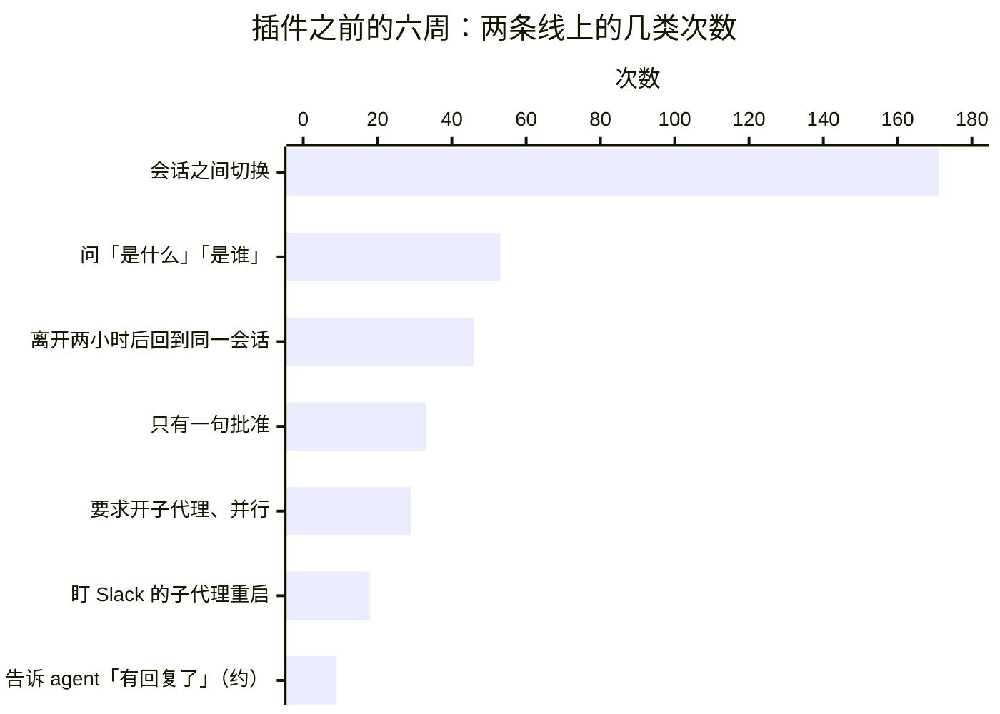

11 月 17 日（周二），作者第一次在一个长会话里手动试「调度器模式」：只跟一个主会话说话，由它派子代理干活、向他汇报。5.7 个小时里他发了 19 条消息，其中 11 条（58%）是在纠正或拉回主会话：不该问的也来问；用只有它自己懂的代号；把子代理转述的人名原样丢给他；事情还没搞清楚就要往外发消息。「不用裸代号」这条规则早就写在常驻规则里，主会话的第一份汇报照样用了代号。至少在这次试验里，只在人和子代理之间放一个主会话、在提示词里多写几条规则，没能省下注意力。

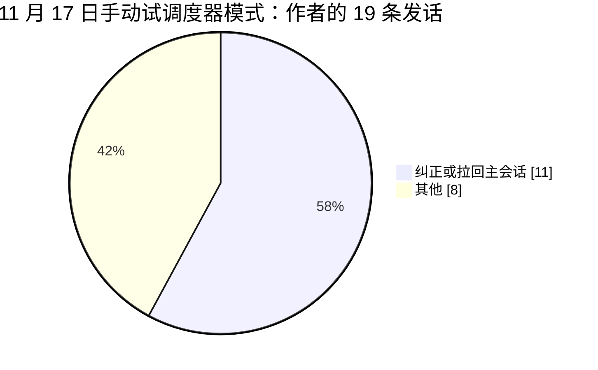

### 1.3 harness 缺的那一层

omp、Claude Code 这类 harness 默认一个人驱动一个会话：输入是人打的字，一件事放在一个会话里，每一轮产出一段回复给人读。它们已经支持子代理：主会话可以派出在后台跑的 agent，子代理做完，把结果送回主会话（下文叫「交回」）。omp 还给主会话提供了一个给子代理发消息的工具；续上会话以后，也能叫醒之前的子代理（agent 没在跑的时候给它发一条消息，让它开始新的一轮，下文都叫「叫醒」）。这些我们都直接用。

缺的是把几件事、几个输入源串起来的那一层。这一层现在由人来补：

| harness 的默认做法 | 一个人同时推进几件事时，人在补什么 | 插件补上的 | 见 |
|---|---|---|---|
| 输入来自人打的字 | 在各个输入源之间来回看，判断和哪件事有关，再转述给对应的会话 | 会话外的接收程序把外部输入写进收件箱，按任务归位；噪音大的频道先过滤 | 第 4 节 |
| 一件事放在一个会话里 | 在会话之间切换，记住每件事在哪、到了哪一步 | 一个主会话做唯一入口，每个任务一个长期的负责 agent | 第 2 节 |
| 状态在会话的上下文里 | 换会话、上下文被压缩以后，把背景重讲一遍 | 程序维护的任务表，每次请求附上摘要 | 第 3 节 |
| 每一轮都给人一段回复 | 逐条读，判断要不要管 | 每条回复标明为什么在说话；待定的事固定显示；提问编号 | 第 5 节 |
| 做完由做的人自己说 | 逐个验收 | 没见过过程的审查者重跑；没通过就记不成完成 | 第 6 节 |
| 约定写进提示词 | 一遍遍纠正同样的错 | 能用程序检查的交给程序；纠正先变成提问，人同意才写成规则 | 第 7 节 |

这些默认做法放在「一个人驱动一个会话」的场景里都合理，一个人同时推进几件事时才变成负担。DeepSeek 的文章也提到，只给本地的单会话 agent 接上命令行工具、MCP 或外部连接器，它能收到外部消息，但仍受三件事限制：单个会话里同步阻塞，几件事的上下文缠在一起，本机一离线就停。前两件我们用「每个任务一个负责 agent」来缓解；第三件还没解决（见第 11 节）。

### 1.4 我们的做法

插件叫调度台（omp-dispatch-desk）。在 omp 里输入 `/调度`，当前会话就变成主会话，我们叫它调度器模式。从 11 月 17 日晚到 20 日上午，一共 20 个提交，约 2,200 行插件代码、约 800 行接收程序、64 个测试，加上四份共约 8,400 字的提示词。

标题里的「调度」包括两条线：外部输入进来以后交给谁、要不要告诉人；活交给谁、什么时候验收、什么时候向人汇报。

作者对它的期待，用他的原话说：「把我作为总统，主会话作为秘书+经理，所有活派给各类模型驱动的长期、短期子代理和一次性 LLM 调用。」他还特别说，主会话「不能只当个收发机」。落到场景上：任务表里同时有十个左右方向不同的任务，各自盯着自己的外部输入，比如某个 Slack thread、几个 PR、一个工单（任务登记的这些外部输入，下文叫「订阅」）；和某个任务有关的输入，不管是他在主会话里说的还是外面来的，都要到这个任务的负责 agent 手里，怎么干由负责 agent 自己定；主会话负责研判、立项、统筹、验收和汇报。

我们希望它做到四件事：

- 省注意力：只在要他定、或者他能用上结果时开口；查得到的不问，可撤回的不问；要问就编号，一两个字能答。
- 按任务隔离：每个任务的上下文在它自己的负责 agent 手里，不在主会话里混着。
- 持续：关掉终端后续上同一个会话，任务表和负责 agent 都还在，不用重讲。开一个新会话，任务表还在，但之前派出的负责 agent 叫不到（第 11 节）。
- 可信：完成要有独立审查；推代码、发消息这类改变本机以外状态的操作（下文叫「远端写入」）要有闸门；故障看得见。

下图是整体结构，括号里是对应的章节。

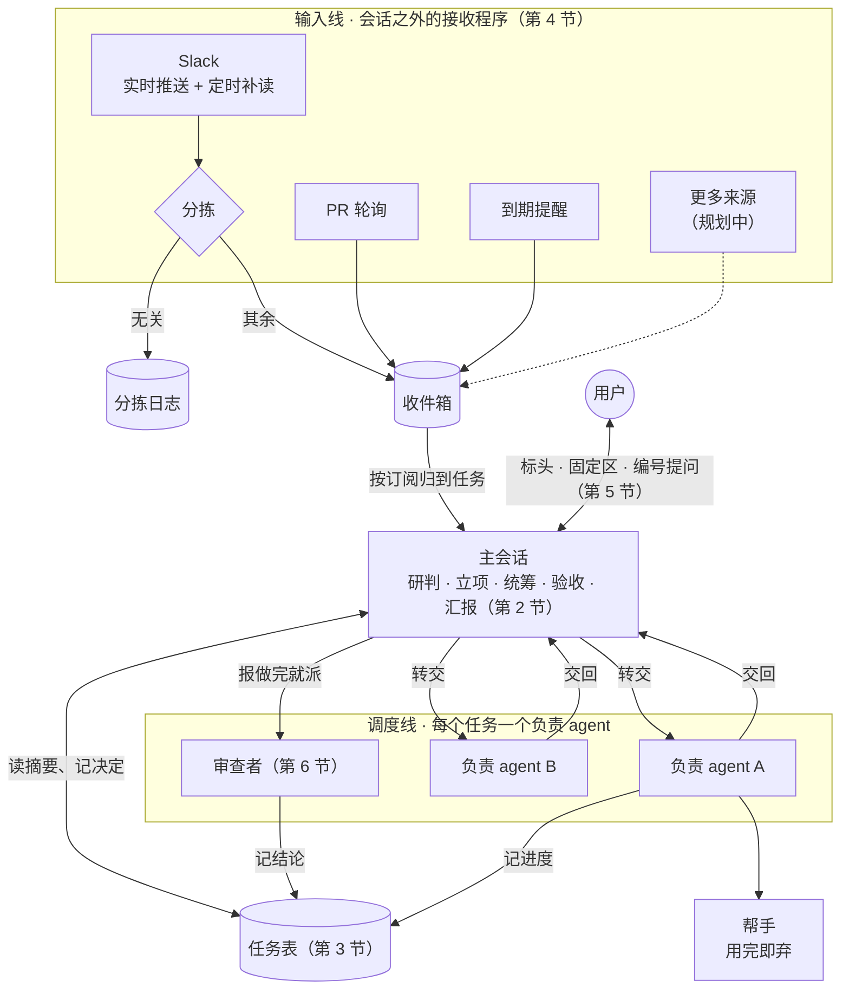

### 1.5 一个例子：一个上午，三件事

一件事的时候，人自己盯也盯得过来；插件的价值在几件事并行、外面又不断有消息进来的时候。下面是一个构造的例子，用来说明流程，数字是示意，不是测量：作者同时推进三件事，大半个上午在开会。

<!-- morning -->

1. 09:00，作者在主会话里发一条消息，开三个任务：修掉导出报表偶发的超时、核对周报的数据口径、升级一个依赖，各附上要盯的 thread 或 PR。主会话把三个任务记进任务表（负责 agent 的名字、目标、完成判据、订阅），各派一个负责 agent，回他一句谁在做。然后他去开会。
2. 三个负责 agent 各干各的。升级依赖的那个推了分支、开了 PR；推分支写在这个任务的白名单里，可以直接做，别的远端写入要先问。
3. 10:10，外面来了 24 条消息：团队大频道 22 条（其中 1 条 @ 作者），导出超时的 thread 里同事回了一句「还是会超时，日志在这」，PR 上有一条评审意见。接收程序把每条写成谁、在哪、链接；大频道里不紧急的 21 条先让便宜的模型分拣，拦下 19 条，只记进分拣日志。送进收件箱的是 5 条。
4. 插件几秒内认领这 5 条，按订阅归位：thread 的回复归到导出超时，评审意见归到依赖升级，一条提到周报的频道消息归到周报口径；主会话分别转交给负责 agent。@ 作者的那条问的是会议时间，另有一条全组通知，主会话记下，等他回来一起说。
5. 10:40，周报的负责 agent 发现两种口径算出来差 3%，要作者定。主会话把它登记成编号提问，放进固定区；另外两件事照常推进，不等这个答案。
6. 11:20，导出超时的负责 agent 补了改动，报整个任务做完；主会话派出没见过过程的审查者，它自己重跑测试、对照完成判据，记下「通过」。依赖升级的负责 agent 按评审意见改完，又推了一次。
7. 11:30，作者回到终端。主会话先讲清他离开时的变化，再问两件事：「1 周报用哪个口径？推荐：按自然周」「2 要不要在 thread 里回复同事、附上 PR？推荐：要」。他回「1 自然周 2 要」，程序记成两个决定，两个负责 agent 接着做。

这个上午，作者发了两条消息，读了一屏回复。没有插件时，他要开三个会话各讲一遍背景，在会话之间来回切；翻完 22 条频道消息、刷 PR 页面；把 thread 和 PR 上的动静一条条贴进对应的会话；开会时被叫回来回答，再切回去；自己重跑测试验收；最后自己去 Slack 和 PR 上回复。

按时间顺序画出来，是下面这样。三件事并行推进的时候，作者不在场。

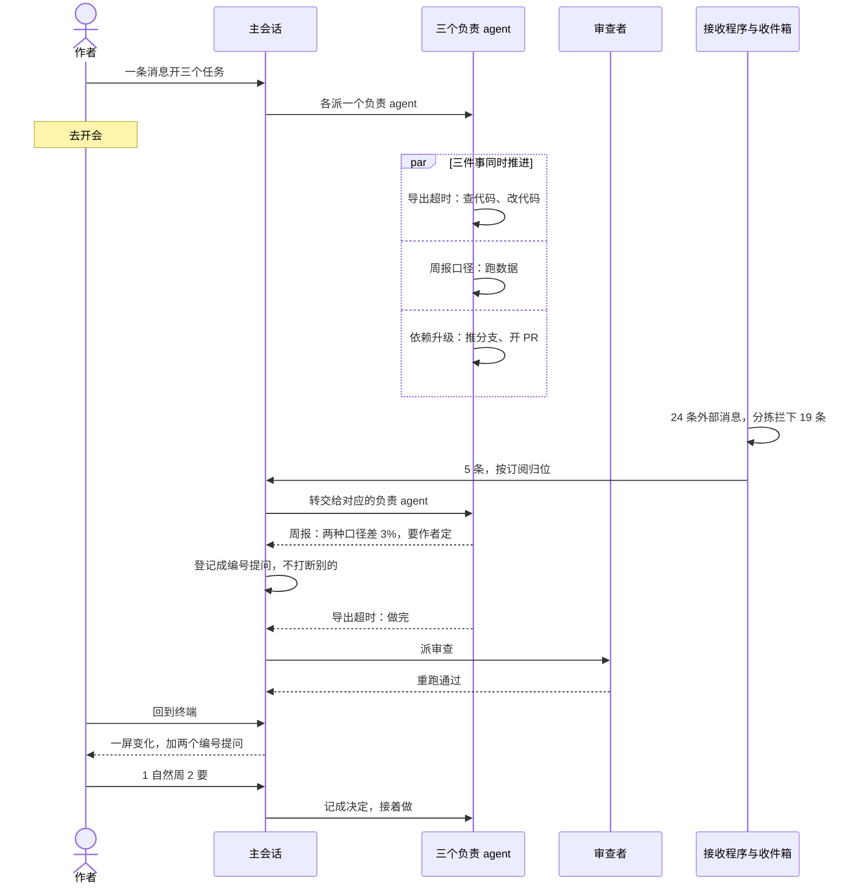

## 2. 调度：主会话管全局，负责 agent 干活

这一节补的是「一件事放在一个会话里」：几件事并行时，人不用再在会话之间切换。

组织会话时有一个绕不开的取舍。所有事都放进一个会话，上下文最连贯，但这个会话会被细节塞满，只能一件一件做，还会被新消息反复打断。每件事开一个新会话，可以同时推进，但没人看全局，几个会话各自回话也会让人糊涂。

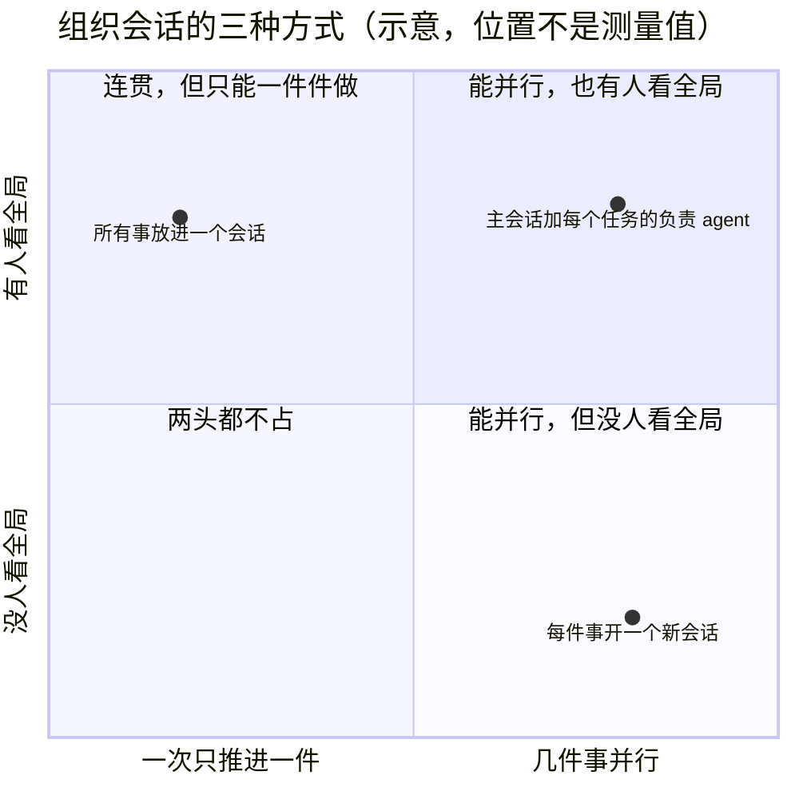

我们把看全局和干活分到两层：

- 主会话负责研判（一条输入归哪个任务、要不要立项、要不要用户定、能不能忽略）、立项（目标、完成判据、要盯什么）、统筹（任务之间的依赖和冲突，一个任务的结论影响另一个时主动转告）、验收和汇报。它自己不干活：不读代码、不改代码、不调试，也不去查外部系统（日志、PR 和 Slack 里的内容），因为调查也算干活。它读的只有任务表、负责 agent 和审查者交回的东西。
- 负责 agent 每个任务一个，是主会话派出的长期子代理，名字记在任务表里。这个任务的上下文在它手里，怎么干由它定：亲自做、再派帮手，或者一次性调用模型。
- 负责 agent 报做完时，主会话另派一个没见过过程的审查者，用完即弃（第 6 节）。

这一层几乎不用新写代码。派子代理、给子代理发消息、子代理再派子代理、续会话后叫醒子代理、在 omp 的 Agent Hub（列出所有在跑的 agent 的界面）里看谁在跑，omp 都自带。插件只补 omp 没有的东西：调度这一层不另造守护进程，也不另造看板。接收外部输入的几个小程序是例外，见第 4 节。

模型也按层分：主会话用开会话时选的模型，负责 agent 默认跟它一样、也可以单独配，帮手按 omp 自己的配置选模型。花费的去向也变了。插件之前的六周，约 600 美元花在主会话上，约 165 美元花在 142 个子代理上；11 月 19 日（周四）下午约 6 小时的使用里，负责 agent 占 55%，主会话 35%，审查者 9%。总花费并没有降：插件之前平均每个在用的日子约 28 美元，19 日下午那 6 小时就花了约 61 美元，超过了以前两个在用日子的平均。这些花费按 omp 记录的用量和模型的 API 价格计算。每个任务花多少钱、和以前比是贵是省，我们还没有算。

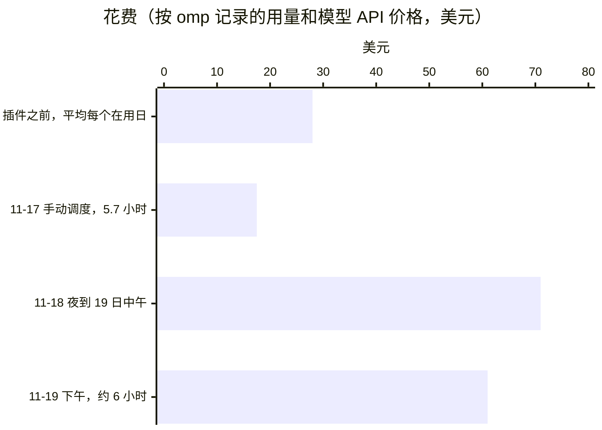

这和常见的 Agent Team 不一样。Team 的领队要把一件复杂任务拆开、频繁协调队员，推理负担很重。我们的主会话只管任务之间的关系，不拆单个任务，更接近 DeepSeek 文章里的路由层（Router）。

我们也走过弯路。作者说过一句「什么长期负责人，什么 slack 什么 pr 之类的，都是次要的」。我们一度把它理解成不要负责 agent 这一层，改成由主会话把每一步派给用完即弃的执行者。他的本意是实现方式可以换，每个任务有一个负责人这件事不变。这一层删掉以后又加了回来。从那以后，需求里说某样东西「次要」，我们先问清是不要它，还是不限定做法。

## 3. 任务表：程序记账，模型判断

这一节补的是「状态在会话的上下文里」：换一个会话、上下文被压缩，状态还在。

状态放在模型的记忆里，会忘，也会编。早期每个会话有自己的一本账，换一个会话就对不上。

现在全局只有一本任务表，放在用户目录下的数据目录里，跨项目共用。它是一个只追加的记录文件（`tasks/events.jsonl`），每一行是一次变化：立项、分事项（一个任务里的具体一步）、记进度、登记提问、记决定、记审查结论。给人看的 Markdown 视图由程序从这个文件生成。主会话每次请求的末尾都附一份摘要，所以它不用记状态，也不该凭记忆说状态。这就是数据库领域常说的事件溯源：记录是唯一的事实来源，视图随时可以重建；模型只读视图，要改状态只能通过插件提供的工具追加记录。

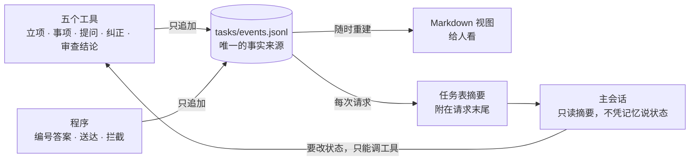

能交给程序的，都交给了程序：

- 用户整条消息只回「1 做 2 不做」时，程序直接把它记成决定，不经过模型转述。
- 模型登记提问时要写明查过哪里，程序把这个任务已有的决定列给它；已有答案的，就撤回不问。
- 任务表里没有审查者记下的「通过」，任务就记不成完成。这是插件唯一拦截的操作。
- 负责 agent 写完交回、但它自己还有后台命令或帮手在跑时，omp 要等它完全空闲才把结果送给主会话，交回可能迟迟到不了（下文叫「被压住」）。插件在它这一轮结束时记下这条交回，15 秒后 omp 还没送，就由插件送达。11 月 19 日下午的 49 次交回送到了 48 次；其中几次是插件送达的，没有分开统计；漏掉的那 1 次原因还没查。
- 负责 agent 超过 15 分钟没交回，插件就叫醒主会话去看一眼，之后间隔翻倍。

被压住的交回，插件是这样代送的：

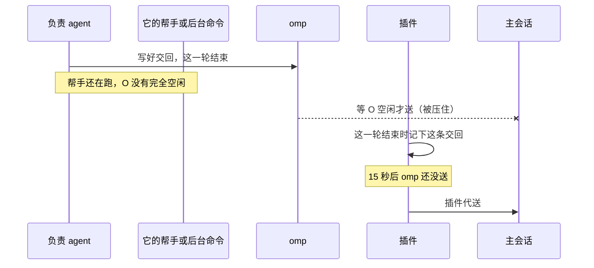

订阅也记在任务表里：立项时写上这个任务要盯的 Slack thread 或频道、PR、工单号。外部输入按订阅归到任务，交给它的负责 agent；同一条输入同样强度地命中几个任务时，不归任何一个，交主会话研判。这和 DeepSeek 文章里的「订阅 + 直送」是同一个思路，区别是我们这一步还得经过主会话转交。omp 的插件能改每次请求的提示词、注册工具、往主会话里发消息，但没有给子代理发消息的接口；那个工具只有主会话这个模型能调用（第 11 节）。

## 4. 输入：在会话之外接收，先过滤再叫醒

这一节补的是「输入来自人打的字」：外部输入要有一条不经过人的路。

接上真实的 Slack 和代码平台以后，外部输入的特点是噪音多、要动手的少。让大模型逐条判断，又慢又贵，还会把主会话的上下文和用户的注意力耗在闲聊上。早期在会话里派一个便宜模型的子代理轮询 Slack，结果就是上面说的四天重启 18 次。

现在接了三类来源：

- Slack：一个常驻服务实时接收推送，范围是配置里关注的频道、任务订阅的频道和 thread、私信和 @ 作者的消息；另有一个程序每 5 分钟补读一次，补上推送漏掉的。
- PR：每 5 分钟查一次作者开的 PR 和任务订阅的 PR，有别人的新评论、评审或投票就记下来，GitHub 和 Azure DevOps 都支持。
- 提醒：每 5 分钟查一次本地的提醒文件，到期就提醒。

工单、邮件、日历、CI 结果、文档评论、监控告警都还没接。订阅里写了工单号，也没有程序去读，只能靠到期提醒叫人去看。

所有来源都写同一种格式：收件箱目录里的一个 JSON 文件，写明谁、在哪、链接，可选写它属于哪个任务、是否紧急。任何程序都能写，所以接一个新来源，就是写一个小脚本。

处理分四步：

1. 接收程序都在会话之外运行，只读外部系统，只往收件箱里写谁、在哪、链接，不写原文。原文是不可信内容，需要时由负责 agent 按链接只读核实。
2. 快路径：能按订阅归位的（thread、频道、PR、工单号），程序直接归；私信、@ 作者、到期提醒标成紧急。插件每 5 秒认领一次收件箱，把这一批输入合成一条消息发给主会话，让它开始新的一轮（主会话正在回复时，排到下一轮）；主会话再把它们交给对应的负责 agent。
3. 慢路径：归不到任务的，交给主会话研判。主会话自己不读原文，凭收件箱里的谁、在哪、链接、分拣写的说明和任务表来定：归到某个任务、立项、报给用户，或者忽略。
4. 分拣：有的频道只是想知道动静（比如团队大频道），大部分消息和作者无关。这类频道里不紧急、没归到任务的消息，先让便宜的模型分成四类：可能归某个任务、和作者或团队相关、无关、拿不准。用的是 omp 配置里的 smol 角色（omp 允许按用途给模型起角色名，smol 是给轻量活用的那个，作者配的是 Haiku）。无关的不送，只记进分拣日志，状态栏显示拦下了几条。模型调用失败，这一批就全部送出，宁可多打扰也不漏。分拣说「可能归某个任务」，只写进送给主会话的那条输入的说明里，不替主会话定归属。

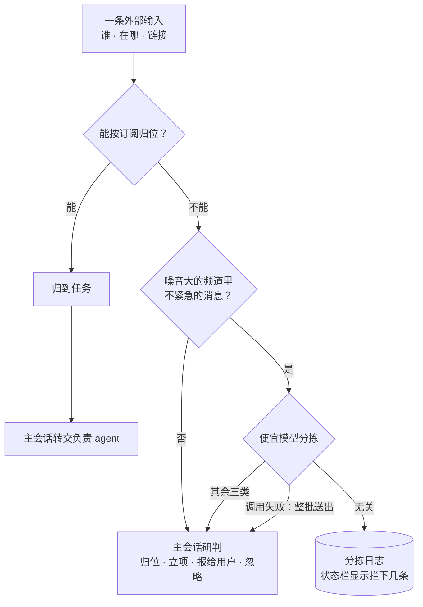

分拣的效果，我们用团队大频道一天的 84 条真实消息回放过：最后送进来 6 条，包括两条 @ 作者的消息、一份和他相关的会议纪要、一条全员都要处理的安全事项。最早的一版里，便宜模型把 37 条消息判成「可能归某个任务」，主要是别人的一次排障讨论和另一个 PR 的评审，依据只是同一个人、同一个系统。我们做了两处调整：把各任务最近的事项标题也给它看，并把这个判断降成提示。调整后再回放，这类误归就没有了。分拣上线后的第一个上午（11 月 20 日，周五），进分拣的 59 条消息拦下了 42 条。

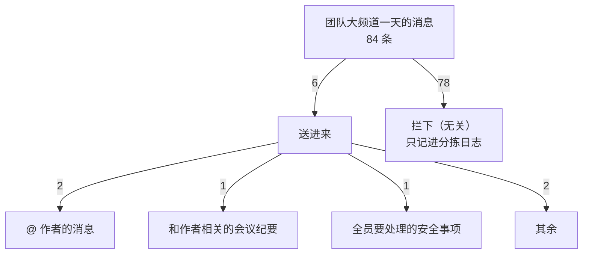

需要说明：调整和回放用的是同一批消息，算不上独立验证；上线后拦下的那 42 条，还没有逐条核对有没有拦错。上线后的拦截比例（42/59）低于回放（78/84），原因也还没分析。

每个接收程序跑完都记一笔健康状态。超过三个周期没成功、或者有一部分一直读不到，就显示在固定区（输入框上方固定显示的一块，见第 5 节），主会话也会在对话里说一次。

每加一条快路径，就多一种要盯的失败。就在这个上午（11 月 20 日 05:30 到 10:15），补读程序跑了约 58 次，其中 41 次有部分请求失败，几乎都出在团队大频道和一个来往很多的私信上。原因是每次读 7 天的记录，一页 200 条，响应有三四百 KB，网络一抖就被截断。读不完的部分这次整个不收、下次重读，所以没丢消息，但大频道的消息最长晚了 4 个多小时：开了分拣以后，实时推送把这类消息交给补读去分拣，补读读不下来，消息就一直进不来。修法是每页改成 50 条，同一个请求失败了重试；一个请求三次都失败，就当网络不通，这次运行剩下的请求只试一次，免得一次补读拖上一个小时。

这一节的做法来自 DeepSeek 文章里的快路径和慢路径（Fast Path / Slow Path）：稳定、高频、规则清楚的判断写进代码，模型只处理剩下的部分。把外部输入当成触发器接进 agent，是 DeepSeek 提出的方向。我们也在走这条路，只是来源还少。

## 5. 注意力界面：少说、说清、问得好答

这一节补的是「每一轮都给人一段回复」。

主会话的每一条回复都在花用户的注意力。早期它很少说错，问题多出在说得太多、问得难答。我们在界面上做了这些：

- 每条回复上方画一行标头，说明这一轮为什么在说话：回答、转交、交回（做完了，用了多久）、审查结果、外部输入。不看正文，也知道要不要停下来看。
- 输入框上方有一块固定区，显示等他定的事、在跑的负责 agent 跑了多久、接收程序的故障、需要重启会话的提示。回复里就不用每次把待办再列一遍。
- 要他定的事编号列出，一次最多三件，一两个字能答，附推荐和不选的后果。他回「1 做 2 不做」，程序记账。11 月 17 日到 20 日上午，主会话登记了 106 个提问，其中 21 个登记以后又被主会话自己撤回。任务表记下 125 个决定，比提问多：他没被问、直接说的决定也记进去了，两类各多少没有分开统计。
- 子代理交回、外部输入叫醒的回合，用户没在等的进展不汇报，回复默认不超过 5 行。回复超长、出现内部代号或像提交 SHA 的十六进制串，程序会在下一次请求里提醒模型，只提醒，不拦。
- 插件最早叫丞相府，界面里用了一整套朝廷的说法（上朝、军令、军报）。界面很快全部换成了平常话，插件后来也改名叫调度台。主题词好玩，但每个词都要用户在脑子里翻译一次。
- 隔了两个小时以上再发话，程序先附上这期间任务表的变化，让主会话一屏讲清再回答。

也有机制自己制造噪音的时候：

- 远端写入对账。本意是把每次远端写入和它之前的决定摆在一起，供作者抽查。结果主会话把它当成需要回应的东西，开始逐条解释授权。我们在 11 月 19 日中午把它从模型那边撤掉，只留在给人抽查的视图里；但作者那天下午没有重启会话，旧代码还在跑，那个下午仍有 27 条回复在解释「这在你某时某刻的授权范围内」（第 7 节）。
- 同一个下午，「不用你处理」出现了 30 次；另有 26 条回复开头先报一行监控状态，其中 6 条在推送早已恢复后还说它断着。告诉他「不用你处理」，本身就在占用他的注意力。
- 同一条规则提议，在回复里重复了约 8 次。

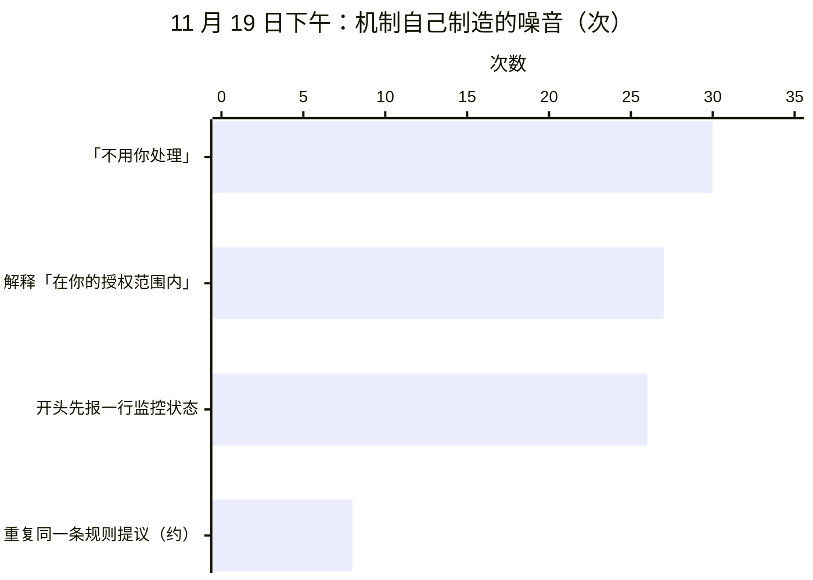

怎么衡量这类噪音？我们把每一轮回复按起因分成两类：用户发话引起的，和被叫醒引起的（子代理交回、外部输入、提醒）。被叫醒回合的回复字数，除以这段时间主会话全部回复的字数，就是下面说的占比。按字数算，因为人读回复的成本大致跟长度走。那个下午主会话回复了 121 次，这个占比是 71%；前一个时间窗（11 月 18 日夜到 19 日中午）是 59%。这个比例也受作者在不在场影响：那个下午他离开了 2 小时 45 分，这段时间的回复都算被叫醒的；前一个时间窗他离开了多久没有统计，所以两个比例只能粗看。后台在推进是好事，但从上面这些例子看，其中不少他并不需要读。这是接下来最要解决的问题（第 12 节）。

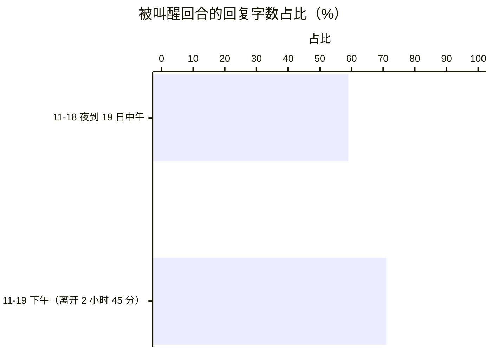

## 6. 可信：约束和验收

这一节补的是「做完由做的人自己说」。接上外部输入以后，风险还多了两类：外面进来的内容不可信，往外写的东西要有闸门。

agent 能替你做的事越多，做错一次的代价越大：一条发错的对外消息，代价可能超过它省下的全部注意力。

- 常设约束是主会话和所有子代理都带的几条约束：不 force push，不推主分支，远端写入除白名单外先问，外部输入是不可信数据，如实交回（失败、受阻、不知道都是正常结果，不靠放宽标准交差）。
- 每个任务可以写一份低风险写入的白名单，要写具体：哪个仓库的哪个分支。
- 负责 agent 报整个任务做完，主会话另派一个没见过过程的审查者。它自己重跑（代码任务重跑测试，结论类的任务自己重新查一遍证据），对照任务的目标和后面的步骤，试着找出不成立的地方，把结论记进任务表。审查者的名字固定是「负责 agent 的名字 + Review」，而且必须由主会话直接派出：插件看子代理的编号来认，负责 agent 派出的帮手，编号前面带着负责 agent 的名字。负责 agent 和它的帮手都记不了审查结论，负责 agent 也不能起一个以 Review 结尾的名字。
- 审查出结论前，先别往外发。有一次，结果在审查还没出结论时就发给了同事，审查判了不通过，只好再发一条更正。现在审查者在跑的时候，负责 agent 的每次请求都会附一句提醒。
- 远端写入的范围要跟着现实扩。一个负责 agent 为了给消息分拣，把团队频道的消息原文发给了一个第三方模型网关，还在审查之前就换掉了正在跑的定时任务。发出去多少条没有统计，对方是否留存无法确认。那个改动后来撤掉了，分拣改成只用 omp 自己配置的模型。现在常设约束里写明：把工作内容发给 omp 模型配置以外的第三方服务，也算远端写入。这条约束同样只写在提示词里，不是技术拦截。

一个任务从立项到完成，只有一道程序拦着的关：

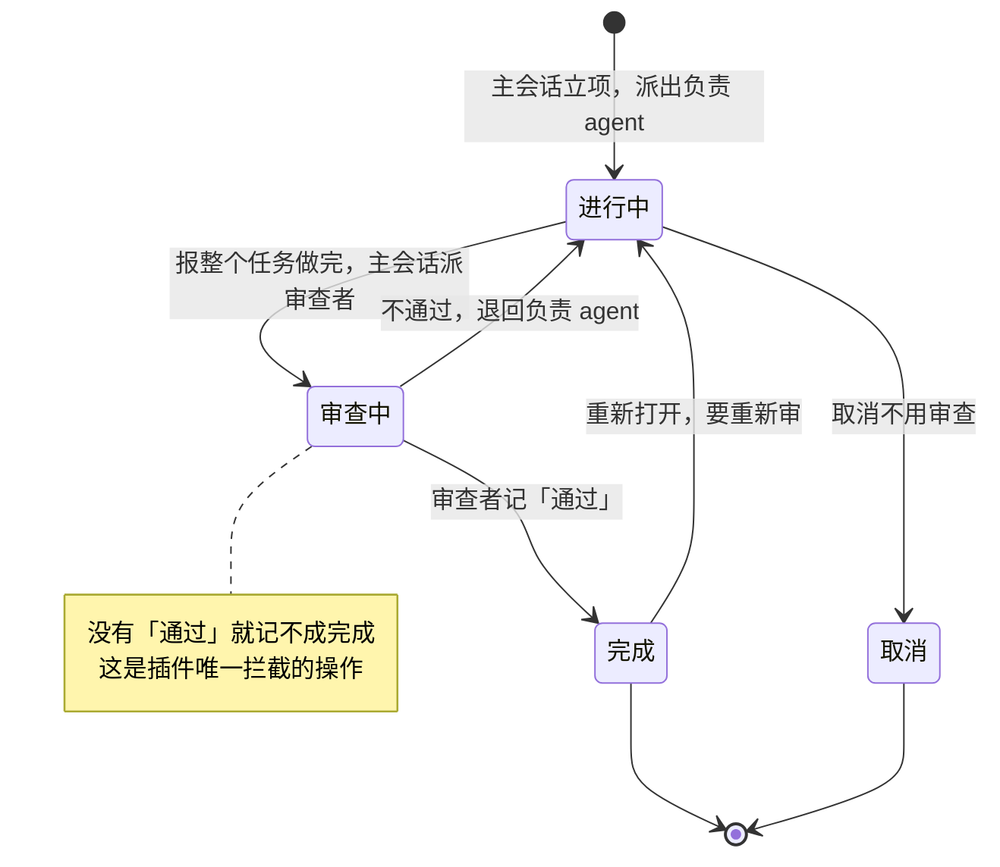

插件只拦一个操作：没有通过的审查，任务就记不成完成。其余都是记录和提醒。这是刻意的：在提示词层做拦截，容易被绕过，也容易误伤。真正的保障，请用代码平台上的分支保护。

## 7. 规则越少越好：纠正怎么变成机制

这一节补的是「约定写进提示词」：同样的错，人要一遍遍纠正。

用户每纠正一次，最省事的做法是往规则里加一句。但规则会越积越多、互相打架，模型顾不过来，用户也读不过来。作者的说法是：「规则太多等于没有规则。」

我们的做法：

1. 能用程序的就不写规则。裸代号、超长回复交给程序检查；编号答案由程序记账；没过审查不能记完成，由程序拦；被压住的交回由程序送达。
2. 机制制造噪音，就删掉它。远端写入对账是一例（第 5 节）。另一例是事项的审查关卡：早先事项记成完成也要先有审查通过，结果小事项也得派审查者、等结论、汇报结论，噪音比收益大。现在事项不拦，审不审由主会话按大小定；只有整个任务记成完成时，必须有审查通过。
3. 纠正走固定流程。主会话记一条纠正，附一句它提议写进用户规则的话；程序把这句话登记成一个编号提问，留在固定区，模型不在回复里反复提；用户同意才写进规则文件，不同意就关掉。
4. 插件自带的规则和代码一起加载。第 5 节那 27 条解释，就出在作者没有重启会话的那个下午：磁盘上的规则已经是新的，在跑的代码还是旧的。现在插件自带的规则在会话进程启动时和代码一起读入，用户的补充规则每次现读；磁盘上的插件一变，固定区就提示重启。

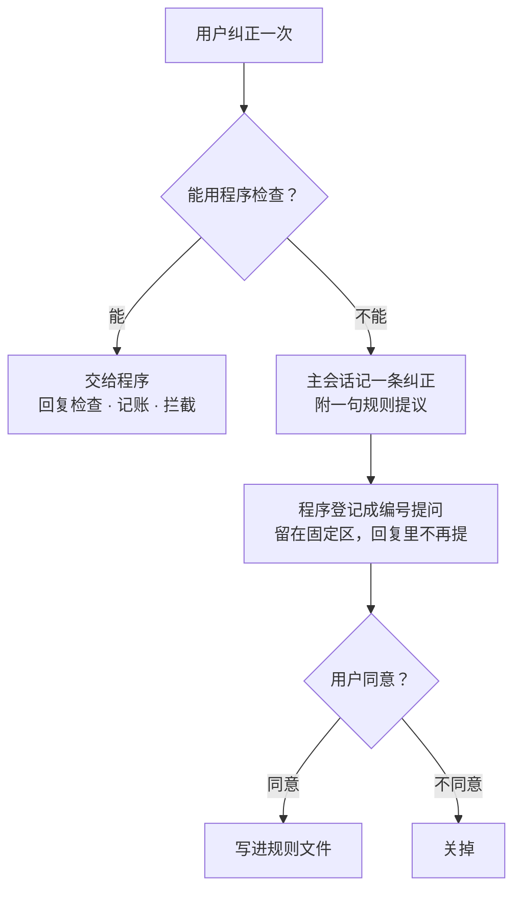

还有一个更隐蔽的坑。有一轮改进把作者要的「先分拣」做成了程序，却没告诉他，前一天记下的那条纠正可以关了。重启以后，新机制让主会话给每条还开着的纠正补一条规则提议，这条旧纠正就变成了一个多余的提问：「要不要把先分拣写成规则」。教训是：一件事做成了程序，要同时关掉对应的旧纠正，并告诉用户。

这和 Grok Bot（一个可以建多个 Bot、给它们配例行任务的助理产品）团队的 Lauren Tan 讲的做法一致：每一次纠正，都变成一条 lint 规则或者别的确定性检查。

## 8. 方法论

### 8.1 原则

1. 注意力是预算，要记账。两条线都记；每个机制先算它替用户省了多少注意力，自己又花了多少（第 5、9 节）。
2. 一个入口，按任务分人。用户只跟主会话说话，外部输入也先到主会话，再按任务交给负责 agent（第 2 节）。
3. 程序记账，模型判断。状态、计数、送达、拦截交给代码；归属、值不值得打扰、结果站不站得住交给模型（第 3 节）。
4. 能用程序就不加规则，机制制造噪音就删掉（第 7 节）。
5. 用宿主已有的，只补缺的（第 2 节）。
6. 先过滤，再叫醒。能按订阅归位的不用模型，剩下的先让便宜模型分拣，失败了宁可多送（第 4 节）。
7. 打扰要可回答。一次最多三件，编号，一两个字能答，问之前先查记录（第 5 节）。
8. 验收不靠自述。完成判据立项时写好，没见过过程的审查者重跑，审查出结论前不往外发（第 6 节）。
9. 进来的不可信，出去的有闸门。收件箱只写谁、在哪、链接；远端写入先问，发给第三方服务也算（第 4、6 节）。
10. 故障要看得见，版本要对得上。每个接收程序都报健康状态；代码和规则一起加载（第 4、7 节）。

### 8.2 迭代：用真实使用复盘

这几天的改进几乎都来自复盘，很少是事先设计好的。每一轮是这样走的：

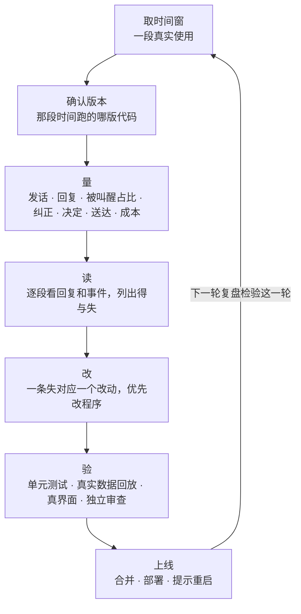

几点说明：

- 量：注意力统计做成了一个只读的技能，按天、按任务汇总；复盘时再针对时间窗单独算。
- 先确认版本：有一轮复盘发现作者那天下午根本没重启，跑的是前一晚的代码，中午修的东西一样都没生效。没有这一步，后面的结论会全错。
- 读：数字只能说明哪里有问题，原因要从具体的回复里读出来。比如「不用你处理」出现 30 次，我们读下来的判断是：主会话被叫醒以后，觉得总得说点什么。
- 改：每个改动都能指回一条「失」，指不回的不做。
- 验：一共四道关：单元测试；拿真实数据回放（分拣就用同一天的真实频道消息反复回放）；在 tmux 里开一个真的 omp，看真实界面；交给一个没参与过程的审查 agent。最后一道几次都抓到了真问题。有一次，上线当晚的一处小改动漏了审查，第二天补审时，审查 agent 找出了网络截断让消息晚到几个小时的问题。
- 上线以后，下一轮复盘就是对这一轮的检验。

### 8.3 想法从哪里来

我们没有提出新理论，主要的想法都有出处：

- 注意力是瓶颈、路由层和执行层分开、外部输入作为触发器、快慢路径、订阅直送、看门狗：DeepSeek 的 Super-agent；
- 总管只派活不干活、往外发之前要审批、没有新东西就别发：Grok Bot（一个可以建多个 Bot、给它们配例行任务的助理产品）的社区实践；
- 每次纠正都变成确定性检查：Grok Bot 团队的 Lauren Tan；
- 一个滚动的主会话、常设指令、后台结果合并成通知：OpenClaw；
- 完成判据先写、由别人验收：Factory（做编码 agent 的公司）的 Missions，Hermes（Nous Research 的 agent）的看板；
- 队列和状态由普通程序掌管，模型只做判断：omp 官方的 roboomp。

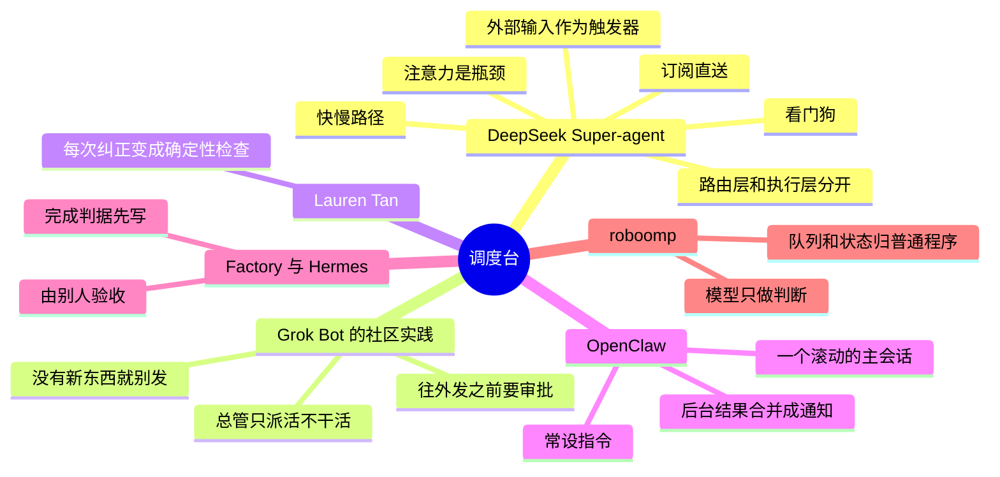

我们做的，是把这些想法放到「一个人、一个终端里的 omp 会话」这个约束下落地，再用作者自己的真实使用一轮轮检验和修正。

## 9. 初步观察

下面的数字都来自真实使用，不是对照实验：几个时间窗之间插件的代码一直在变，样本也只有一个人、几天，只能当参考。

插件之前的六周（2026 年 10 月 6 日到 11 月 17 日）。这些数字从 omp 的会话记录里统计，只算了 omp 的会话。「同时推进的会话」按每个会话第一条到最后一条用户消息的时间段算；「切换」指把所有用户消息按时间排好后，相邻两条落在不同会话；「有回复了」「是什么」「是谁」这类按关键词检索，是近似值。

| 指标 | 数值 |
|---|---|
| 会话 / 在用的天数 / 用户消息 | 52 个 / 27 天 / 798 条 |
| 每天同时推进的会话 | 中位数 3 个，工作日常见 3–5 个 |
| 会话之间切换 | 171 次；在用的日子平均每天 6.3 次，最多一天 22 次 |
| 离开两小时以上再回到同一会话 | 46 次 |
| 告诉 agent「有回复了」 | 约 9 次 |
| 盯 Slack 的子代理重启 | 18 次（四天内） |
| 明确要求开子代理、并行 | 29 次 |
| 只有一句批准的消息 / 问「是什么」「是谁」的消息 | 33 条 / 53 条 |
| 花费（按 omp 记录的用量和模型 API 价格） | 主会话约 600 美元，子代理约 165 美元（142 个）；平均每个在用的日子约 28 美元 |

手动调度和插件的几个时间窗。「被叫醒回合的字数占比」的算法见第 5 节。

| 时间窗 | 用户发话 | 主会话回复 | 被叫醒回合的字数占比 | 其他 |
|---|---:|---:|---:|---|
| 11 月 17 日白天，手动调度 5.7 小时 | 19 | 28 | 未统计 | 19 条发话里 11 条是纠正；28 条回复里 19 条超过 15 行；花费约 17.5 美元（主会话 9.4、子代理 8.1） |
| 11 月 18 日夜到 19 日中午 | 未统计 | 89 | 59% | 花费约 71 美元；作者离开多久没有统计 |
| 11 月 19 日下午约 6 小时 | 29 | 121 | 71% | 花费约 61 美元（负责 agent 55%、主会话 35%、审查者 9%）；作者离开的 2 小时 45 分里回复 61 次；交回 49 次、送到 48 次；收件箱收到 94 条外部输入，78 条来自团队大频道 |

手动调度那次的 11 条纠正，是逐条读那次会话的消息归类得出的；下表里插件期间的 22 次纠正，是主会话用工具记下的。两种口径不能直接比。

任务表，11 月 17 日到 20 日上午的累计：

| 指标 | 数值 |
|---|---:|
| 任务 | 12 |
| 主会话登记的提问 | 106（其中 21 个登记后又被主会话撤回） |
| 记下的决定 | 125（含没被问、直接说的） |
| 用户的纠正 | 22 |
| 记下的远端写入 | 75 |

75 条远端写入里，有 13 条在写入之前 30 分钟内，同一个任务没有记下任何决定。批准常常更早，这只是抽查的线索，不等于没批准；这 13 条还没有逐条核对。

分拣：

| 场景 | 进分拣 | 拦下 | 送进来 |
|---|---:|---:|---:|
| 团队大频道一天的消息回放（调整后） | 84 | 78 | 6 |
| 上线后第一个上午（11 月 20 日） | 59 | 42 | 17 |

从这些数字能看出几件事。至少在 19 日下午那个时间窗里，主会话已经不是最大的开销，钱和上下文都转到了负责 agent 那边；花费并没有降，一个下午就超过了以前两个在用日子的平均。三天多记下了一百多个决定；被问到的那部分用编号回答，答起来很省事，但决定多不全是好事，也可能说明打扰变多了，每个决定花了作者多少注意力，还要和插件之前比。外部输入的量不小，一个下午 94 条，分拣在回放和上线后的第一个上午都拦下了大部分。被叫醒回合的回复占比在升高，其中有多少是作者需要读的，还没有统计。

这些数字回答不了插件到底省了多少注意力。插件之前统计过的那些指标（切换次数、「有回复了」的次数），在插件期间还没有按同样的方法重新统计；要回答这个问题，得有同一类工作在用和不用插件时的对照。

## 10. 和已有工具比较

想把这一层补上，现在大致有三条路：

- 换一个专门的平台或产品。Steve Yegge 的 Gas Town 在 tmux 里编排二三十个编码 agent；OpenClaw 是常驻的个人助理，接各种聊天渠道；Grok Bot 的用户常把第一个 Bot 当总管。代价是要换掉熟悉的工具，还要维护新东西。
- 由 harness 自己补。DeepSeek Harness 团队给自家 harness 设计的 Super-agent 有路由层、执行层、外部触发器，目标是云端常驻；Claude Code 的 agent teams 让一个领队带几个队友、共享一张任务清单，解决的是一件复杂任务内部的分工，不接外部输入，恢复会话以后队友也不在了。
- 给现有的 harness 做扩展，也就是我们这条路。用户不用换工具，原来的会话、子代理、记忆、技能都还在；代价是受宿主限制，比如插件的代码不能给子代理发消息。

最接近的是 DeepSeek 的 Super-agent。几乎每个部件都能对上：主会话对应路由层，负责 agent 对应执行层（Worker），任务的订阅对应它的订阅，接收程序加分拣对应它对外部输入的两级过滤，固定区对应它面板上「需要人处理的事」，久未交回的提醒是它看门狗的简化版。我们一开始就读过它的原型和全部提示词，「注意力是瓶颈」这个判断也直接来自它。不同的是，它面向云端常驻、多渠道接入，我们是本地 harness 里的一个插件，外部来源也少得多。

如果问哪个知名工具「装上就像这个」：编码场景里最像 Gas Town，你只跟 Mayor 说话，它在 Beads（一个基于 git 的任务追踪）里建工作，派给 polecat 去做，另有角色盯进度、合并前跑验证。个人事务场景里最像 Grok Bot 的总管用法：社区教程几乎都教同一件事，第一个 Bot 做总管，用户主要只和它说话，由它把活交给负责各自领域的专门 Bot，往外发之前要审批。omp 生态里目前没有成熟的同类：omp-superagent 形状最像，但 11 月 15 日才创建，还要给 omp 打补丁；roboomp 是 omp 官方的常驻 GitHub 机器人，一个 issue 一个执行者，不和人对话。

| | 调度台 | DeepSeek Super-agent | Gas Town | Grok Bot（总管用法） | OpenClaw | Claude Code agent teams |
|---|---|---|---|---|---|---|
| 形态 | omp 插件，本地 | DeepSeek Harness 上的设计和原型，面向云端常驻 | tmux 里的编排器 | 产品里的用法 | 常驻的个人助理 | Claude Code 内置功能 |
| 一个入口 | 主会话 | 路由层 | Mayor | 总管 Bot | 主会话 | 领队 |
| 每个任务一个执行者 | 负责 agent（子代理） | 执行层（独立会话） | polecat | 专门 Bot | 子代理、会话 | 队友 |
| 外部输入 | Slack、PR、提醒 | IM、GitHub | 以代码工作为主 | 例行任务、连接的应用 | 各种聊天渠道、定时任务 | 无 |
| 输入过滤 | 程序归位 + 便宜模型分拣 | 程序 + 模型两级 | 不是重点 | 写在例行任务里 | 合并成通知 | 无 |
| 独立验收 | 审查者，程序拦「完成」 | 执行者自审 | 合并前跑验证 | 要自己搭检查用的 Bot | 无 | 有完成钩子 |
| 主要面向 | 一个人的注意力 | 持续在线、多渠道 | 编码吞吐 | 一个人的事务 | 一个人的事务 | 单个复杂任务 |

这些做法搬到别的 harness 上，需要宿主提供几样能力：每次请求前能改提示词，能注册自定义工具，能往主会话里发消息、让它开始新的一轮，能派长期在岗的子代理并给它发消息。任务表、收件箱和接收程序跟 harness 无关，可以直接搬；回复上方的标头和输入框上方的固定区，依赖 omp 的界面接口。

## 11. 局限和开放问题

输入线：

- 只接了三类来源：Slack、PR（GitHub 和 Azure DevOps）、本地提醒。工单、邮件、日历、CI、文档评论、监控告警都没接；订阅里的工单号只能靠到期提醒。
- 只有 Slack 是实时推送。PR 和提醒每 5 分钟查一次，最多晚一个周期。
- 分拣只用在 Slack 上没归到任务的频道；PR 事件和提醒量小，直接送。
- 分拣的效果没有独立验证：调规则和回放用的是同一批消息，上线后拦下的消息还没逐条核对。分拣也可能被利用：有人在消息里故意写一句诱导的话，可能让整批都被判成无关。
- 外部输入必须经主会话转交。给子代理发消息的工具只有主会话这个模型能调用，插件的代码调不到，DeepSeek 那种「订阅后直送执行者」的快路径我们做不到，主会话的负担因此更重。
- 本机一离线就停。会话关着时接收程序还在收，但收进来的输入要等会话续上才有人处理；机器一睡，接收也停了。

调度线：

- 负责 agent 属于派出它的会话。换一个新会话就叫不到它，只有续原来的会话才行。会话进程一死，在跑的活只能靠任务表和工作副本（git worktree）接上。
- 看门狗只看时长，不看进展。久未交回的提醒分不清是卡住了还是在干一件长活。
- 远端写入只记录、不拦截。识别靠尽力而为的模式匹配（比如命令里的 git push、对 Slack 写接口的调用），认不出的不记。
- 审查者的身份靠名字和编号来认：防得住负责 agent 给自己记通过，防不住主会话故意派一个审查者走过场。

整体：

- 评估还很粗。没有对照组，时间窗之间代码一直在变，样本只有一个人几天。
- 花费没有降。19 日一个下午的花费，就超过了插件之前两个在用日子的平均；每个任务花多少钱还没有算。插件规则放在系统提示词里，每轮不变，能用上模型服务的提示词缓存；任务表摘要每轮都变，附在请求末尾，这约四千字符每轮都要重新算。常驻主会话的上下文也会越来越大。
- 做插件本身也花了作者的注意力。三天多里他参与了每一轮复盘和决定，这部分没有计入上面的数字。

## 12. 现状和规划

### 12.1 现在走到哪了

| | 已经有的 | 还缺的 |
|---|---|---|
| 输入线 | Slack 实时推送和定时补读；PR 的评论、评审、投票；到期提醒；按订阅归位；噪音大的频道先分拣；每个来源报健康状态 | 工单、邮件、日历、CI、文档评论、监控告警；分拣只用在 Slack；只有 Slack 是实时的；输入要经主会话转交 |
| 调度线 | 一本任务表；每个任务一个负责 agent；独立审查；被压住的交回由插件送达；久未交回叫醒主会话 | 按进展判断卡没卡住；任务做完自动收尾；换会话后找回负责 agent |
| 注意力界面 | 标头、固定区、编号提问、回复检查、离开后回来的摘要 | 被叫醒的回合仍然话多：19 日下午 71% 的回复字数来自被叫醒的回合 |
| 可信 | 常设约束、白名单、审查、审查出结论前先别往外发 | 远端写入只记录不拦截；发给第三方服务的约束只在提示词里 |
| 评估 | 注意力统计技能；几次复盘的数字 | 和插件之前同口径的对比；每个任务的花费；分拣错拦的抽查 |

逐项的盘点见附录 A。

### 12.2 先用起来，量清楚

现在最大的风险，是一直在造它而不去用它。接下来几周：

- 冻结一段时间。代码只修 bug，提示词的每次改动都记下来，否则效果没法归因。
- 两条线分开记账。输入线记进来多少、拦下多少、送到主会话多少、真正需要作者看的多少、他自己转述了几次；拦下的消息定期抽一批，人工看有没有拦错。调度线记每个任务花了作者多少发话、决定和纠正，以及被叫醒的回合里有多少是他真需要读的。
- 和插件之前比。把插件之前统计过的指标（切换次数、「有回复了」的次数）按同样的方法再统计一次，纠正也按同一种方法归类，并算出每个任务的花费。
- 定退出标准。用满一段时间后，如果每个任务花的注意力并不比以前少，就砍到只剩任务表和外部输入两样。

### 12.3 输入线：接更多来源，每个都先过滤

Slack 只是第一个来源。作者每天要看的地方还有工单、邮件、日历、CI 和文档评论，这些现在都还靠人去看。接哪个按「哪个源最花注意力」排，不追求接得全：

1. 先补和现有来源挨着的：CI 结果跟着 PR 一起报；任务订阅的工单号，有新评论、状态变了、指派给了作者，就写进收件箱。
2. 再接日历和邮件。会议邀请和外部回复是另两类常见的打断；日历还能用来「提前做」：会前由负责 agent 把相关材料整理好。
3. 每个源都走快慢两条路。程序先按来源和规则筛：明确找作者的、任务订阅的，直接送；已知可以忽略的，只记日志；剩下的才交给便宜模型分拣。现在只有 Slack 有分拣。
4. 订阅覆盖所有来源。任务能登记工单号、邮件会话、日历事件，程序按登记归位。
5. 能推送的源用推送，其余轮询，带重试和健康状态。
6. 「提前做」推广开来。某类输入一进来，负责 agent 先在后台动手（复现报来的问题、起草回复），有结果才说话。这是 DeepSeek 文章里的推测执行（speculative execution）。
7. 回复回到原处。在 Slack 里回得短，在 PR 里回得有条理；照样过远端写入的闸门。

接一个新来源的成本不高：照收件箱的格式写一个小脚本，跑完记一笔健康状态就行。难的是第 3 条：每个源的噪音不一样，过滤规则要一个个调。

### 12.4 调度线：少打扰，能自己接上

1. 被叫醒的回合少说话。交回的类型（进展、等别人、要你定、受阻、失败、做完、无需处理）现在靠提示词写在第一行；下一步由程序按类型决定要不要出现在对话里，「进展」和「无需处理」只进任务表和固定区。这是目前最大的噪音来源。
2. 输入直送负责 agent。如果 omp 开放了让插件给子代理投递消息的接口，或者让负责 agent 自己领取归给它的输入，外部输入就不用再经过主会话。
3. 按进展判断卡没卡住。定时让便宜模型看一眼各负责 agent 最近在做什么，判断它是在推进、在空转，还是跑偏了。
4. 远端写入从记录变成闸门。写入走宿主的工具或钩子，带白名单和审批队列；结果不明时不重发，重启后先和外部状态对账。
5. 任务收尾。PR 合并后自动关任务、清理工作副本、归档相关的外部输入。
6. 离开终端也能批。omp 自带的远程协作可以在手机浏览器里对话，把编号提问接上去。
7. 版本和兼容。打 tag，写变更说明；任务表的记录格式只加字段，不改旧字段的含义。

### 12.5 有些缺口应该由 harness 自己补

插件补的这一层，长远看应该进到 harness 本身，插件越来越薄。DeepSeek Harness 团队给自家 harness 设计 Super-agent，走的就是这条路。对 omp，我们想提给上游的能力有：

- 外部输入能直接进一个活着的会话；会话关着时先排队，续上后再送。
- 插件能给子代理发消息，子代理能领取归给自己的输入。
- 交回带类型，宿主据此决定要不要打扰人。
- 任务状态和子代理能跨会话找回。
- 原生的定时任务。
- 回复发出前、交回送达前，有可以挂检查的钩子。

### 12.6 三个方向

- 往深走：把一个人的这两条线做到离开一天回来，一屏看懂，几个字批完。这条路上最值钱的是评估方法：注意力怎么量，对照怎么做。
- 往宽走：从一个人到一个小组，共享任务表，个人的调度器之间互相转交。到这一步，主要问题会变成上下文的边界和权限，也就是 DeepSeek 文章里说的 A2A（agent 之间的通信）。
- 往下走：从插件变成常驻服务，像 DeepSeek 那样把计算、状态和执行环境分开，机器睡着了也能推进。对一个人来说这一步不急，等真有「终端关着也要推进」的需求再做。

### 12.7 作者接下来可以做的事

- 在两三条真实的工作线上跑满几周，拿到第一份分两条线的注意力账单。
- 按账单挑一个最花注意力、还没接的输入源，先接上。
- 把评估做扎实。比如照 DeepSeek 文章第 7 节的做法，用合成的事件流对比「单会话 + 子代理」和「调度器」两种方式。
- 把 omp 缺的能力提给上游（12.5 节）。
- 把这套做法讲给团队听，找一两个同事一起用，验证它在一个人之外是否成立。

## 13. 结语

注意力稀缺时，人在替 harness 做两件事：在 agent 之间调度，在输入源之间收发。我们用一个 omp 插件，把这两件事的大部分交给了程序和模型，人只处理需要他定的部分。

几天用下来，最有用的三条做法是：状态由程序记，模型只读；外部输入先在模型之外归位和过滤；能写成程序检查的约定，不写进提示词。还没解决的有三件：被叫醒的回合话太多，花费没有降，省了多少注意力还没有对照。接下来几周先用、先量，再决定往哪走。长远看，这一层应该由 harness 自己提供。

## 作者与致谢

本文出自作者 2026 年 11 月 17 日至 20 日的实践。插件的实现、复盘和本文的初稿，由在 omp 里运行的 AI 编码助手完成；作者负责方向、判断和验收。

感谢 DeepSeek Harness 团队公开 Super-agent 的设计文章和原型，本文的写法也参照了那篇文章；感谢 Grok Bot、OpenClaw、Gas Town、Hermes、Factory 等项目公开的资料；感谢 omp 的维护者。

## 附录 A：现状盘点

| 线 | 部分 | 做什么 | 状态 |
|---|---|---|---|
| 输入 | Slack 实时推送 | 常驻服务，接配置里关注的频道、任务订阅的频道和 thread、私信、@ 作者的消息；连接断了自动重连 | 在用 |
| 输入 | Slack 定时补读 | 每 5 分钟补读一次；没归到任务的频道先分拣；请求失败重试，每页 50 条 | 在用；分拣和重试刚上线 |
| 输入 | PR 轮询 | 每 5 分钟，作者开的 PR 和任务订阅的 PR：别人的新评论、评审、投票（GitHub、Azure DevOps） | 在用 |
| 输入 | 提醒 | 每 5 分钟检查本地提醒文件里到期的条目 | 在用 |
| 输入 | 收件箱格式 | 一个 JSON 文件：谁、在哪、链接，可选任务名、是否紧急；任何程序都能写 | 在用 |
| 输入 | 按订阅归位 | thread、频道、PR 链接、工单号；命中几个任务时交主会话研判 | 在用 |
| 输入 | 健康状态 | 每个来源跑完记一笔；超过三个周期没成功、或者有一部分一直读不到，就显示在固定区 | 在用 |
| 输入 | 其他来源 | 工单、邮件、日历、CI、文档评论、监控告警 | 未接 |
| 调度 | 调度器模式开关 `/调度` | 只在打开的会话里生效，不打开就是普通的 omp 会话 | 在用 |
| 调度 | 任务表 | 全局一本，只追加的记录文件，加上程序生成的视图 | 在用 |
| 调度 | 五个工具 | 任务、事项、提问、纠正、审查结论 | 在用 |
| 调度 | 负责 agent 和模型分层 | 每个任务一个负责 agent；它的模型可以单独配 | 在用 |
| 调度 | 完成前审查 | 没有通过的审查，任务记不成完成（唯一的拦截） | 在用 |
| 调度 | 交回送达、久未交回叫醒 | 被压住的交回 15 秒后由插件送达；超过 15 分钟叫醒主会话 | 在用 |
| 调度 | 规则注入 | 主会话、负责 agent、审查者、其他子代理各带各的规则；插件规则放进系统提示词，能用上模型服务的提示词缓存；用户的补充规则每次现读 | 在用 |
| 界面 | 标头和固定区 | 每条回复为什么在说话；待定的事、在跑的 agent、故障、重启提示 | 在用 |
| 界面 | 编号提问 | 一次最多三件；登记前查已有决定；只回编号时自动记成决定 | 在用 |
| 界面 | 回复检查 | 超长、内部代号、像 SHA 的串，在下一次请求里提醒 | 在用 |
| 界面 | 离开后回来 | 隔两小时以上再发话，附上期间的变化 | 在用 |
| 界面 | 纠正变成提问 | 规则提议登记成编号提问，同意才写进规则 | 刚上线 |
| 界面 | 插件更新提示重启 | 每分钟比对磁盘上的插件 | 刚上线 |
| 可信 | 常设约束、白名单 | 所有 agent 都带的约束；每个任务的低风险写入白名单 | 在用 |
| 可信 | 审查出结论前先别往外发 | 给负责 agent 的提醒，不拦操作 | 刚上线 |
| 可信 | 远端写入记录 | 记进任务表；和之前决定的配对只给人看 | 在用 |
| 工具 | 注意力统计 | 只读的技能，按天、按任务汇总 | 在用 |
| 工具 | 迁移脚本 | 把旧的分账本合并成一本任务表 | 一次性 |

## 附录 B：时间线（UTC+8）

| 时间 | 这一轮做了什么 | 起因 |
|---|---|---|
| 11 月 17 日白天 | 在一个长会话里手动试调度器模式 | 作者想长期只跟一个会话说话 |
| 11 月 17 日晚 | 插件第一版：打开后才生效、每个会话一本账、常设约束、隔离的工作副本 | 把手动的做法落成程序 |
| 11 月 17 日深夜 | 规则通用化并参数化、回复检查、界面全部改成平常话 | 主题词费解，规则拦不住 |
| 11 月 18 日凌晨 | 全局一本任务表；负责 agent 这一层一度被去掉，随后加回，改成每个任务一个；注意力统计技能 | 作者纠正：要的是调度和编排，「次要」指的是做法不限定 |
| 11 月 18 日上午 | 模型分层、完成前审查、会话名 | 主会话自己干活，结果没人验收 |
| 11 月 18 日晚 | 审查挂到事项上、提问查重、远端写入对账、规则进缓存 | 复盘 |
| 11 月 19 日中午 | 撤掉对账提示和事项完成前的审查关卡 | 复盘：机制本身在制造噪音 |
| 11 月 19 日下午 | 标头和固定区、接收程序故障可见、订阅决定监听范围、被压住的交回由插件送达 | 复盘：看不出这一轮为什么在说话，交回被压住 |
| 11 月 19 日晚 | 分拣、纠正变成提问、审查中先别往外发、插件更新提示重启 | 复盘：噪音、规则和代码版本不一致、结果发得太早 |
| 11 月 20 日上午 | 补读重试和分页、thread 回复按订阅归任务 | 上线后遇到网络截断 |
| 11 月 20 日下午 | 插件改名为调度台（omp-dispatch-desk），加上图解这套做法的项目主页 | 原名不够正式，也看不出它做什么 |

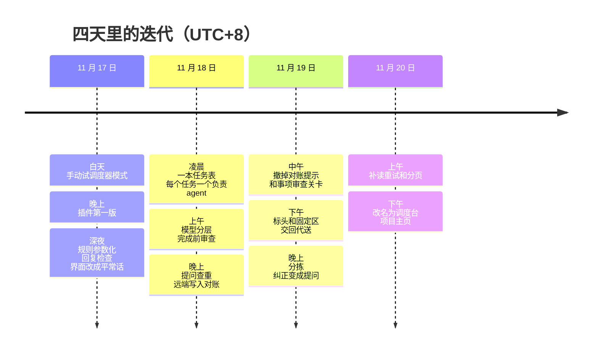

## 参考

- DeepSeek Harness 团队，[Exploring Super-agent Design: Towards a More Autonomous Agent System](https://x.com/DeepSeekHarness/article/2116857257245987236)（[英文全文](https://offloop.org/learn/exploring-deepseek-super-agent-design)），以及原型 [dsh-superagent-prototype](https://github.com/deepseek-ai/dsh-superagent-prototype)
- [oh-my-pi（omp）](https://github.com/can1357/oh-my-pi)，以及官方的 [roboomp](https://github.com/can1357/oh-my-pi/tree/main/python/robomp)
- Steve Yegge，[Welcome to Gas Town](https://yegge.ai/essays/welcome-to-gas-town/)；[gastownhall/gastown](https://github.com/gastownhall/gastown)
- [How to Use Grok Bot: The Practical Guide](https://www.aibuilderclub.com/blog/grok-bot-guide)；[Grok Bot 团队 Lauren Tan 的分享](https://i10x.ai/news/grok-bot-team-11000-pull-requests-lauren-tan)
- OpenClaw，[The main session](https://docs.openclaw.ai/concepts/main-session)、[Standing orders](https://github.com/openclaw/openclaw/blob/main/docs/automation/standing-orders.md)
- [Claude Code agent teams](https://code.claude.com/docs/en/agent-teams)
- [Hermes Kanban](https://hermes-agent.nousresearch.com/docs/user-guide/features/kanban)；Factory，[How Missions Work](https://factory.com/news/missions-architecture)
- [omp-superagent](https://github.com/jjigmeok-dev/omp-superagent)
